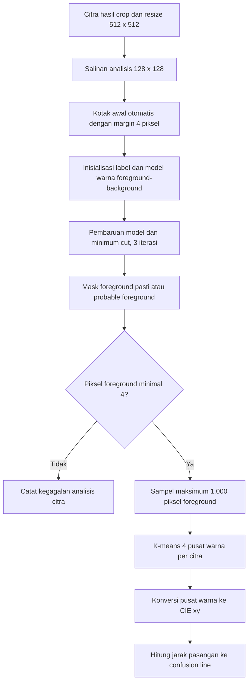
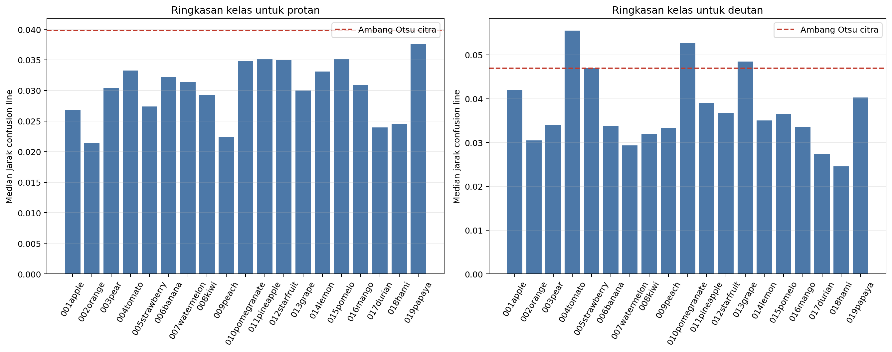

# Analisis Hasil NB01: Praproses Dataset

## Alur Penelitian

```mermaid
flowchart LR
    A[4.870 citra dari 19 kelas train] --> B[Deduplikasi pHash intra-kelas]
    B --> C[4.692 citra crop dan resize]
    C --> D[GrabCut dan K-means per citra]
    D --> E[4.656 citra valid, 36 gagal analisis]
    E --> F[Jarak pasangan warna ke confusion line]
    F --> G[Filter kelas dan citra dengan Otsu per tipe]
    G --> H[Undersampling per kelas lalu penyeimbangan antar-tipe]
    H --> I[525 pilihan protan dan 525 pilihan deutan]
```



NB01 menggunakan semua kelas train kecuali `000neg`. Setelah deduplikasi, citra di-crop dan di-resize ke 512 x 512. GrabCut memperkirakan foreground pada salinan 128 x 128, lalu K-means merangkum warna foreground menjadi empat pusat warna. Jarak pasangan pusat warna terhadap confusion line dihitung per citra dan diringkas per kelas. Seleksi otomatis berbasis ambang Otsu diikuti dua tahap undersampling.

Hasil akhir memuat 525 keanggotaan citra untuk protan dan 525 untuk deutan. Ada 101 citra yang terpilih pada keduanya, sehingga manifest gabungan memuat 949 citra unik dan 1.050 baris keanggotaan. Angka di bawah berasal dari output aktif notebook dengan segmentasi, bukan eksperimen `tanpa segmentasi`, `wt domain`, atau `no kmeans`.

---

## Landasan Teori, Persamaan Literatur, dan Formulasi Operasional

### 1. Deduplikasi Perceptual Hash dan Jarak Hamming

#### A. Persamaan dan Makna

\[
d_H(h^{(1)},h^{(2)})=\sum_k\mathbf{1}[h_k^{(1)}\ne h_k^{(2)}].
\]

Jarak menghitung jumlah bit hash yang berbeda. Implementasi memanggil `imagehash.phash` dan membandingkan hash dalam kelas yang sama. Ambang `PHASH_THRESHOLD = 4` adalah parameter operasional; kedekatan hash tidak menjamin dua citra identik secara semantik.

#### B. Implementasi Operasional pada NB01

Berkas diurutkan, lalu dibandingkan dengan citra yang sudah dipertahankan. Sebanyak 178 dari 4.870 citra terdeteksi sebagai duplikat, menyisakan 4.692 citra. Deduplikasi belum dilakukan lintas kelas.

### 2. Normalisasi Geometris

#### A. Parameter dan Proses

Sisi crop adalah `min(tinggi, lebar)`. Area persegi dipotong dari tengah dan diubah menjadi 512 x 512 piksel dengan `cv2.INTER_AREA`. Rasio aspek area yang dipotong dipertahankan, tetapi objek di tepi dapat terpotong.

#### B. Implementasi Operasional pada NB01

Normalisasi menyamakan resolusi, tanpa mengoreksi pencahayaan atau mengkalibrasi warna kamera. Salinan 128 x 128 piksel digunakan pada segmentasi untuk mengurangi biaya komputasi.

### 3. GrabCut dan K-means pada Area Objek per Citra

#### A. Tujuan Penggunaan GrabCut

GrabCut digunakan untuk memperkirakan area foreground sebelum warna representatif citra dihitung. Citra buah dapat memuat daun, ranting, langit, meja, atau latar warna statis. Jika semua piksel langsung dimasukkan ke analisis warna, latar yang luas dapat menguasai distribusi warna. Mask GrabCut membatasi piksel yang menjadi masukan pengambilan sampel dan K-means.

Tujuan operasionalnya adalah mengurangi kontribusi latar terhadap warna representatif. Foreground hasil algoritma masih merupakan perkiraan objek; label tersebut tidak otomatis berarti seluruh pikselnya adalah buah. GrabCut tidak mengenali nama atau jenis buah dan tidak menentukan apakah warnanya ambigu bagi protan atau deutan. Pengukuran confusion line dilakukan setelah segmentasi dan ekstraksi pusat warna.

#### B. Landasan Literatur dan Persamaan

Rujukan asli adalah Rother, C., Kolmogorov, V., dan Blake, A. (2004), *?GrabCut?: Interactive Foreground Extraction Using Iterated Graph Cuts*, ACM Transactions on Graphics, 23(3), 309-314. [Halaman publikasi Microsoft Research](https://www.microsoft.com/en-us/research/publication/grabcut-interactive-foreground-extraction-using-iterated-graph-cuts/) dan [PDF artikel asli](https://www.microsoft.com/en-us/research/wp-content/uploads/2004/08/siggraph04-grabcut.pdf).
Pang et al., Research on Improved Image Segmentation Algorithm Based on GrabCut, Electronics, 2024, 13, 4068 (https://doi.org/10.3390/electronics13204068)
Early Detection of Jujube Shrinkage Disease by Multi-Source Data on Multi-Task Deep Network, Sensors, 2025, 25, 6763 (https://doi.org/10.3390/s25216763)

Pada **Bagian 3.1, halaman ketiga PDF, Persamaan (7)**, fungsi energi ditulis:

\[
E(\alpha,k,\theta,z)=U(\alpha,k,\theta,z)+V(\alpha,z).
\]

**Persamaan (8)** mendefinisikan biaya data:

\[
U(\alpha,k,\theta,z)=\sum_n D(\alpha_n,k_n,\theta,z_n).
\]

Makna simbol:

| Simbol | Makna |
|---|---|
| $z_n$ | Vektor warna piksel ke-$n$. |
| $\alpha_n$ | Label segmentasi: 0 untuk background dan 1 untuk foreground. |
| $k_n$ | Komponen Gaussian yang ditugaskan kepada piksel. |
| $\theta$ | Bobot, mean, dan kovarians model Gaussian. |
| $U$ | Biaya ketidakcocokan warna piksel dengan modelnya. |
| $V$ | Biaya ketidakteraturan label piksel bertetangga yang mempertimbangkan kontras warna. |

Biaya Gaussian dijabarkan pada Persamaan (9). Pembaruan komponen Gaussian, parameter model, dan segmentasi melalui minimum cut dijelaskan pada Bagian 3.2 serta Gambar 3. [Lokasi persamaan dalam PDF](https://www.microsoft.com/en-us/research/wp-content/uploads/2004/08/siggraph04-grabcut.pdf#page=3).

Persamaan tersebut menjadi dasar algoritma yang dipanggil melalui `cv2.grabCut`. NB01 tidak menulis ulang optimasi energi tersebut.

#### C. Alur Penggunaan pada NB01



1. **Menyiapkan salinan analisis.** Citra hasil praproses dibaca dalam urutan kanal BGR. Fungsi `grabcut_object_pixels` mengubah ukurannya menjadi 128 x 128 piksel menggunakan `cv2.INTER_AREA`. Warna untuk analisis berikutnya berasal dari salinan kecil ini.
2. **Menentukan kotak awal.** Margin dihitung dengan `max(1, round(min(width, height) * 0.03))`. Pada ukuran 128 x 128, hasilnya 4 piksel. Kotak menjadi `(4, 4, 120, 120)` dalam format `(x, y, width, height)`. Jadi, kotak mencakup hampir seluruh gambar dengan bingkai tipis di tepi, bukan hanya separuh area tengah.
3. **Menginisialisasi label.** Mode `GC_INIT_WITH_RECT` menetapkan wilayah di luar kotak sebagai background pasti. Wilayah di dalam kotak menjadi kandidat foreground yang masih dapat diklasifikasikan ulang. Kotak ini menyatakan asumsi lokasi objek, bukan hasil deteksi buah.
4. **Memperbarui model dan segmentasi.** OpenCV memperkirakan distribusi warna foreground/background dengan GMM dan menjalankan optimasi graph cut. NB01 meminta tiga iterasi. Fungsi mengubah isi `mask` dan model warna yang diberikan.
5. **Membentuk mask Boolean.** Label `GC_FGD` dan `GC_PR_FGD` digabung menjadi `True`; dua label background menjadi `False`. Piksel berlabel `True` menjadi sumber analisis warna.
6. **Memeriksa kecukupan piksel.** Jika jumlah foreground kurang dari empat, analisis citra dihentikan dan pesan kesalahan disimpan. Pemeriksaan ini hanya menjamin jumlah piksel cukup untuk permintaan empat cluster, bukan menjamin empat warna yang berbeda atau mask yang benar.
7. **Meneruskan warna ke K-means.** Maksimum 1.000 piksel foreground dipilih tanpa pengembalian. Kanal BGR diubah ke RGB dan nilainya dibagi 255. Empat pusat warna kemudian digunakan dalam pengukuran confusion line.

Perilaku inisialisasi kotak dan label foreground/background mengikuti [dokumentasi resmi OpenCV GrabCut](https://docs.opencv.org/4.x/d8/d83/tutorial_py_grabcut.html).

#### D. Pemanggilan Fungsi dan Arti Argumen

Kode inti yang digunakan:

```python
cv2.grabCut(
    small,
    mask,
    rect,
    background_model,
    foreground_model,
    3,
    cv2.GC_INIT_WITH_RECT,
)
foreground = np.isin(mask, (cv2.GC_FGD, cv2.GC_PR_FGD))
```

| Argumen / Nilai | Penggunaan di NB01 |
|---|---|
| `small` | Citra BGR uint8 berukuran 128 x 128. |
| `mask` | Array label uint8 berukuran sama dengan citra analisis; awalnya nol dan diisi ulang oleh mode inisialisasi. |
| `rect` | Kotak awal otomatis `(4, 4, 120, 120)` pada konfigurasi aktif. |
| `background_model` | Array float64 `(1, 65)` untuk penyimpanan internal model background. |
| `foreground_model` | Array float64 `(1, 65)` untuk penyimpanan internal model foreground. |
| `3` | Jumlah iterasi yang diminta untuk setiap citra. |
| `GC_INIT_WITH_RECT` | Inisialisasi berdasarkan kotak. |
| `foreground` | Mask Boolean yang dipakai untuk mengambil piksel sampel. |

Ukuran `(1, 65)` merupakan kebutuhan antarmuka OpenCV, bukan jumlah kelas buah atau jumlah cluster warna yang ditentukan NB01. Array model dan mask dibuat kembali untuk setiap citra; model warna tidak dipakai bersama antar kelas atau antar gambar. [Dokumentasi argumen OpenCV](https://docs.opencv.org/4.x/d8/d83/tutorial_py_grabcut.html).

Label OpenCV adalah `GC_BGD = 0`, `GC_FGD = 1`, `GC_PR_BGD = 2`, dan `GC_PR_FGD = 3`. Pada inisialisasi kotak tanpa koreksi manual, foreground hasil pemisahan dapat tetap berlabel probable foreground. Kata *probable* merupakan kategori label, bukan nilai probabilitas terkalibrasi yang diekspor notebook.

#### E. Parameter Operasional dan Dampak Perubahannya

| Pengaturan | Nilai Aktif | Tujuan dan Dampak Jika Diubah |
|---|---|---|
| `SEGMENTATION_SIZE` | 128 | Mengurangi biaya komputasi. Ukuran lebih kecil dapat menghilangkan detail batas; ukuran lebih besar menambah detail dan biaya pemrosesan. |
| `GRABCUT_BORDER_FRACTION` | 0,03 | Menyediakan bingkai background awal. Margin lebih besar memaksa lebih banyak tepi menjadi background dan dapat memotong buah; margin lebih kecil memberi contoh background yang lebih sedikit. |
| Jumlah iterasi | 3 | Membatasi pembaruan model/segmentasi. Penambahan iterasi meningkatkan biaya dan dapat mengubah mask, tetapi tidak menjamin objek yang salah akan menjadi benar. |
| `COLOR_SAMPLES_PER_IMAGE` | 1.000 | Batas sampel setelah GrabCut. Sampel lebih sedikit dapat membuat pusat warna lebih peka terhadap pengacakan. |
| `KMEANS_CLUSTERS` | 4 | Jumlah pusat warna untuk analisis lanjutan. Ini terpisah dari komponen Gaussian internal GrabCut. |

Ukuran 128, margin 3%, tiga iterasi, dan batas 1.000 sampel adalah pilihan operasional NB01. Nilai tersebut belum dibuktikan optimal untuk dataset ini dan tidak dinyatakan sebagai rekomendasi universal dari paper GrabCut. Seed 42 digunakan pada sampling dan K-means; kode tidak menetapkan seed OpenCV secara eksplisit tepat sebelum setiap pemanggilan GrabCut.

#### F. Hubungan Mask dengan K-means, Confusion Line, dan Citra Keluaran

Mask menentukan piksel mana yang masuk pengambilan sampel. Jika daun atau latar ikut foreground, warnanya dapat menghasilkan pusat cluster dan memengaruhi jarak confusion line. Sebaliknya, jika sebagian buah terbuang, warna bagian tersebut tidak terwakili. Dampaknya dapat merambat dari statistik per citra ke mean/median kelas, ambang Otsu, dan keputusan seleksi.

K-means dijalankan per citra pada RGB. Jumlah anggota cluster tidak digunakan sebagai bobot median jarak pasangan pusat warna. Karena itu, pusat warna dari bagian foreground yang relatif kecil tetap ikut dalam pasangan jarak yang diringkas.

Mask hanya digunakan untuk analisis warna NB01. Citra yang diekspor tetap citra penuh 512 x 512 hasil crop dan resize, sehingga NB02 menyimulasikan buah beserta latarnya. NB03 juga menghitung Delta E00 seluruh piksel. Oleh sebab itu, seleksi warna berbasis foreground tidak berarti hasil simulasi dan evaluasi sudah bebas kontribusi latar.

#### G. Audit Visual dan Batas Metodologis

Untuk pratinjau, mask 128 x 128 diperbesar ke 512 x 512 dengan interpolasi nearest-neighbor. Area di luar mask digelapkan menjadi 25% intensitas citra pada overlay. Penggelapan hanya membantu melihat wilayah yang dipilih dan tidak diterapkan pada file citra untuk simulasi. Tampilan tepi mask dapat terlihat bertangga akibat pembesaran resolusi.

Audit perlu memperhatikan apakah permukaan buah masuk mask, apakah tepi buah terpotong, dan apakah daun, ranting, atau latar luas masih ikut. Enam pratinjau awal yang disediakan notebook belum mewakili kualitas seluruh kelas. Kolom `foreground_fraction` mencatat proporsi piksel terpilih, tetapi notebook tidak menerapkan ambang kualitas berdasarkan proporsi itu.

Pada hasil aktif, 36 citra gagal karena foreground tidak cukup untuk K-means. Status `ok` pada 4.656 citra lainnya berarti proses komputasi berhasil, bukan validasi bahwa mask sesuai objek buah. Kegagalan segmentasi perlu dibedakan dari penolakan oleh filter confusion line.

Inisialisasi kotak dibuat otomatis untuk menjalankan pipeline tanpa anotasi per gambar. Asumsi ini paling rentan ketika buah menyentuh bingkai, objek tidak terpusat, atau warna latar menyerupai buah. Kode saat ini tidak melakukan koreksi mask manual maupun evaluasi mask terhadap anotasi acuan. Dengan demikian, tujuan pengurangan pengaruh latar dapat dijelaskan, tetapi keberhasilannya pada seluruh dataset belum boleh dianggap sudah terukur.

### 4. Pengukuran Jarak terhadap Confusion Line

#### A. Persamaan Acuan Notebook

NB01 merujuk persamaan jarak titik ke garis pada Tsekouras et al. (2021), Persamaan 12:

\[
d(v,L)=\frac{|(x_{cp}-x_0)(y_0-v_y)-(x_0-v_x)(y_{cp}-y_0)|}{\sqrt{(x_{cp}-x_0)^2+(y_{cp}-y_0)^2}}.
\]

#### B. Keterangan Variabel dan Parameter NB01

`(x_cp, y_cp)` adalah copunctal point: protan (0,763; 0,236) dan deutan (1,4; -0,4). `(x_0, y_0)` merupakan pusat warna pembentuk garis, sedangkan `(v_x, v_y)` merupakan pusat warna pembanding. Empat pusat menghasilkan enam pasangan yang diperiksa dua arah, atau 12 jarak per tipe untuk satu citra.

#### C. Referensi dan Ruang Lingkup Adaptasi

[Tsekouras et al. (2021), A Novel Approach to Image Recoloring for Color Vision Deficiency](https://doi.org/10.3390/s21082740) membahas ekstraksi warna kunci dan pemetaan confusion line untuk recoloring. GrabCut, K-means empat cluster, median dua arah, dan filter kelas merupakan adaptasi pipeline penelitian ini. Keseluruhan pipeline bukan replikasi identik metode artikel tersebut.

#### D. Interpretasi

Jarak kecil menunjukkan kedekatan geometris pasangan warna terhadap garis kebingungan yang sama. Ini bukan bukti bahwa buah sulit dikenali semua penderita CVD. Warna yang memang sudah mirip juga dapat menghasilkan jarak kecil. Luminansi dan variasi warna dalam cluster belum dinilai oleh jarak xy saja.

### 5. Otsu pada Distribusi Jarak Per Citra

#### A. Kriteria Ambang

\[
t^*=\arg\max_t\sigma_B^2(t),\qquad
\sigma_B^2(t)=\omega_0(t)\omega_1(t)[\mu_0(t)-\mu_1(t)]^2.
\]

Histogram berisi median jarak pasangan warna per citra. Rentang minimum-maksimum dipetakan ke 0-255 sebelum `cv2.THRESH_OTSU`, lalu ambang dikembalikan ke skala jarak. Pemetaan menghasilkan kuantisasi 256 tingkat. Otsu tidak lagi diterapkan pada saturasi gabungan kelas.

#### B. Implementasi Operasional pada NB01

Ambang protan 0,039806634985 dan deutan 0,046999706471 dihitung terpisah dari 4.656 citra valid. Ambang membagi distribusi data dan tidak dikalibrasi sebagai ambang persepsi manusia.

### 6. Filter Kelas dan Filter Citra

#### A. Aturan Pemilihan

Kelas lolos jika mean dan median dari median jarak per citranya sama-sama tidak melebihi ambang tipe. Di dalam kelas lolos, hanya citra dengan median jarak tidak melebihi ambang yang menjadi kandidat undersampling. Aturan gabungan ini adalah keputusan operasional, bukan persamaan seleksi kelas buah dari artikel recoloring.

#### B. Hasil dan Sensitivitas Batas

Protan memilih 17 kelas; banana dan papaya tidak lolos. Deutan memilih 15 kelas; tomato, strawberry, pomegranate, dan grape tidak lolos. Semua 19 kelas tetap terwakili pada gabungan.

Mean protan banana adalah 0,039806941217, sedikit di atas ambang 0,039806634985, walaupun mediannya di bawah ambang. Keputusan ini sensitif terhadap perubahan sampel, segmentasi, dan kuantisasi ambang. Pembulatan enam desimal dapat menyembunyikan selisih tersebut.

### 7. Penyeimbangan Jumlah per Kelas dalam Setiap Tipe

#### A. Formulasi Operasional

Kuota tipe adalah jumlah kandidat terkecil di antara kelas yang lolos untuk tipe tersebut. Pengambilan acak memakai `random_state = 42`. Kuota minimum mendeskripsikan desain sampling notebook dan tidak diklaim sebagai persamaan artikel confusion line.

#### B. Hasil Otomatis pada Dataset

Sebelum penyeimbangan antar-tipe, tahap undersampling per kelas menghasilkan 17 kelas x 64 = 1.088 kandidat protan dan 15 kelas x 35 = 525 kandidat deutan. Tahap berikutnya menyamakan jumlah total antar-tipe pada 525. Akibatnya, jumlah akhir protan per kelas tidak lagi seragam; deutan tetap 35 citra per kelas. Pemilihan acak memakai `random_state = 42`.

---

## Tahapan Eksekusi dan Hasil Pemrosesan

### 1. Inventarisasi Data Sumber

Dataset train memuat 4.870 citra pada 19 kelas setelah kelas `000neg` dikecualikan. Pipeline aktif tidak menggunakan seleksi rentang hue merah/hijau; keputusan kelas dibuat dari jarak warna ke confusion line dan ambang Otsu.

### 2. Deduplikasi dan Resize

Sebanyak 178 citra terdeteksi duplikat intra-kelas, menyisakan 4.692 citra. Citra keluaran utama berukuran 512 x 512. Ukuran 128 x 128 hanya dipakai sementara dalam segmentasi GrabCut, lalu mask diterapkan pada resolusi kerja untuk ekstraksi warna.

### 3. Analisis Foreground dan Confusion Line

Analisis berhasil pada 4.656 citra dan gagal pada 36 citra karena foreground hasil GrabCut tidak mencukupi untuk K-means. Kegagalan ini tidak dihitung sebagai jarak warna. Rata-rata dan median jarak per kelas dihitung dari citra yang berhasil dianalisis.

### 4. Seleksi Kelas dan Citra

Ambang Otsu per citra adalah 0,0398066 untuk protan dan 0,047000 untuk deutan. Sebanyak 17 kelas lolos untuk protan dan 15 kelas untuk deutan. Keanggotaan kedua kelompok dapat tumpang tindih. Kiwi, misalnya, lolos karena seleksi memakai jarak geometris pusat warna hasil segmentasi, bukan label semantik warna buah.

### 5. Undersampling dan Ekspor

Undersampling awal menghasilkan 1.088 kandidat protan (17 kelas x 64) dan 525 kandidat deutan (15 kelas x 35). Untuk menyamakan jumlah total antar-tipe, protan kemudian diambil ulang secara acak menjadi 525. Hasil akhirnya 525 per tipe, 1.050 baris keanggotaan, 101 citra yang dipakai pada kedua tipe, dan 949 citra sumber unik. Karena sampling kedua tahap, distribusi akhir protan per kelas bervariasi.

---

## Ringkasan Hasil Praproses

| Parameter / Metrik | Nilai |
| --- | --- |
| Kelas sumber | 19 |
| Citra mentah | 4.870 |
| Duplikat intra-kelas | 178 |
| Citra setelah resize | 4.692 |
| Analisis berhasil / gagal | 4.656 / 36 |
| Ambang Otsu protan / deutan | 0,039807 / 0,047000 |
| Hasil kuota per kelas sebelum penyeimbangan antar-tipe | 1.088 / 525 |
| Jumlah kelas protan / deutan | 17 / 15 |
| Jumlah akhir protan / deutan | 525 / 525 |
| Citra pada irisan kedua tipe | 101 |
| Citra unik dalam manifest gabungan | 949 |
| Dimensi keluaran | 512 x 512 piksel |

Jumlah citra unik dihitung sebagai 525 + 525 - 101 = 949. Folder tipe menyimpan keanggotaan seleksi, sehingga satu sumber dapat muncul di kedua folder.

---

## Rincian Distribusi Kelas Sebelum dan Sesudah Undersampling

| Kelas | Analisis valid | Kandidat protan | Final protan | Kandidat deutan | Final deutan |
| --- | ---: | ---: | ---: | ---: | ---: |
| 001apple | 397 | 320 | 29 | 232 | 35 |
| 002orange | 422 | 342 | 35 | 319 | 35 |
| 003pear | 263 | 167 | 28 | 178 | 35 |
| 004tomato | 403 | 293 | 34 | 0 | 0 |
| 005strawberry | 438 | 369 | 37 | 0 | 0 |
| 006banana | 372 | 0 | 0 | 244 | 35 |
| 007watermelon | 223 | 138 | 34 | 174 | 35 |
| 008kiwi | 300 | 228 | 29 | 232 | 35 |
| 009peach | 400 | 317 | 30 | 281 | 35 |
| 010pomegranate | 261 | 166 | 37 | 0 | 0 |
| 011pineapple | 210 | 129 | 35 | 132 | 35 |
| 012starfruit | 154 | 90 | 27 | 105 | 35 |
| 013grape | 148 | 97 | 32 | 0 | 0 |
| 014lemon | 141 | 86 | 27 | 91 | 35 |
| 015pomelo | 112 | 64 | 30 | 73 | 35 |
| 016mango | 143 | 95 | 28 | 101 | 35 |
| 017durian | 112 | 88 | 26 | 90 | 35 |
| 018hami | 99 | 78 | 27 | 87 | 35 |
| 019papaya | 58 | 0 | 0 | 35 | 35 |

Kolom kandidat menunjukkan citra yang lolos ambang warna sebelum pembatasan jumlah. Kolom final menunjukkan keanggotaan setelah undersampling dua tahap. Protan berjumlah 525 secara keseluruhan, tetapi kuota per kelas berubah setelah disamakan dengan total deutan. Deutan memiliki 35 citra per kelas untuk 15 kelas.

---

## Analisis Hubungan Antar-Variabel: Keterkaitan ke NB02 dan NB03

### 1. Apa yang Dipersiapkan di NB01?

NB01 memilih citra dengan jarak pasangan warna relatif rendah terhadap confusion line sesuai model dan ambang yang digunakan. Ukuran ini berbeda dari Delta E00 antara citra asli dan hasil simulasi di NB03. Keduanya menjawab pertanyaan berbeda.

### 2. Mengapa Penyeimbangan Dilakukan?

Penyeimbangan akhir menghasilkan jumlah citra sama antara protan dan deutan, yaitu 525 per kelompok. Langkah ini menyamakan ukuran kelompok, tetapi tidak menyamakan komposisi kelas: protan memiliki 17 kelas dengan jumlah per kelas bervariasi, sedangkan deutan memiliki 15 kelas dengan 35 citra per kelas.

### 3. Hubungan dengan Tahap Downstream (NB02 dan NB03)

NB02 membuat 525 x 4 = 2.100 simulasi per tipe, total 4.200 keluaran. NB03 mengevaluasi keluaran tersebut. Irisan 101 identitas memungkinkan analisis berpasangan pada 101 x 4 = 404 pasangan kondisi, sementara ringkasan utama memakai 525 citra pada masing-masing tipe.

### 4. Bagaimana Kontrol Kualitas Ditegakkan?

Identitas sumber, hash, status analisis, dan jarak warna disimpan untuk audit. Keberhasilan GrabCut tidak menjamin mask hanya berisi buah. Seleksi otomatis juga bukan validasi langsung terhadap persepsi peserta dengan CVD.

---

## Artefak Aktif

| Berkas Keluaran | Makna |
| --- | --- |
| [dataset_preparation_summary.json](output/dataset_preparation_summary.json) | Jumlah tahap, parameter, ambang, kelas terpilih, dan hasil penyeimbangan akhir. |
| [deduplication_report.csv](output/deduplication_report.csv) | Catatan duplikat intra-kelas. |
| [dataset_preparation_errors.csv](output/dataset_preparation_errors.csv) | Log kesalahan praproses; kegagalan analisis warna disimpan terpisah. |
| [confusion_line_image_analysis.csv](output/confusion_line_image_analysis.csv) | Status analisis dan jarak per citra. |
| [confusion_line_class_summary.csv](output/confusion_line_class_summary.csv) | Statistik jarak per kelas dan keputusan filter. |
| [confusion_line_filter_summary.csv](output/confusion_line_filter_summary.csv) | Ambang Otsu, jumlah kelas, dan jumlah citra akhir per tipe. |
| [confusion_line_selected_by_cvd.csv](output/confusion_line_selected_by_cvd.csv) | Manifest seleksi yang menjadi input utama NB02. |
| [dataset_preparation_report.csv](output/dataset_preparation_report.csv) | Status keanggotaan manifest gabungan. |
| [confusion_line_filtered/](output/confusion_line_filtered/) | Citra terpilih dalam subfolder protan dan deutan. |
| [confusion_line_class_summary.png](output/confusion_line_class_summary.png) | Median jarak kelas dan ambang Otsu. |

---

## Penjelasan Visual Aktif

### Grafik Ringkasan Jarak Kelas dan Ambang Otsu



Panel merangkum median jarak kelas untuk protan dan deutan; garis putus-putus menunjukkan ambang Otsu yang dihitung dari distribusi jarak per citra. Median yang lebih rendah berarti pusat warna kelas lebih dekat secara geometris ke garis yang digunakan. Keputusan seleksi juga memakai kriteria kelas pada notebook, sehingga grafik median saja tidak cukup untuk merekonstruksi keputusan setiap kelas.

### Audit Mask dan Distribusi Jarak Per Citra di Notebook

Notebook menampilkan contoh overlay mask dan distribusi jarak. Overlay membantu menilai area yang dipakai pada contoh, sedangkan distribusi memperlihatkan variasi antar-citra yang tidak ditangkap satu nilai ringkasan. Contoh mask tidak membuktikan bahwa seluruh mask pada semua kelas sudah benar; hasil warna tetap bergantung pada segmentasi otomatis.
