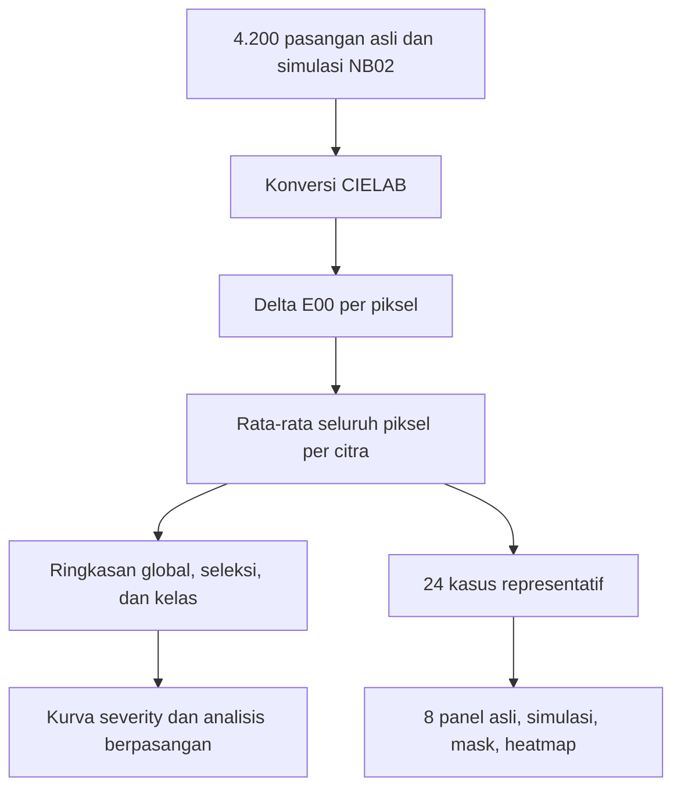
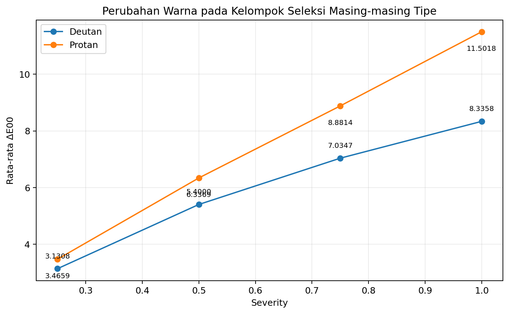
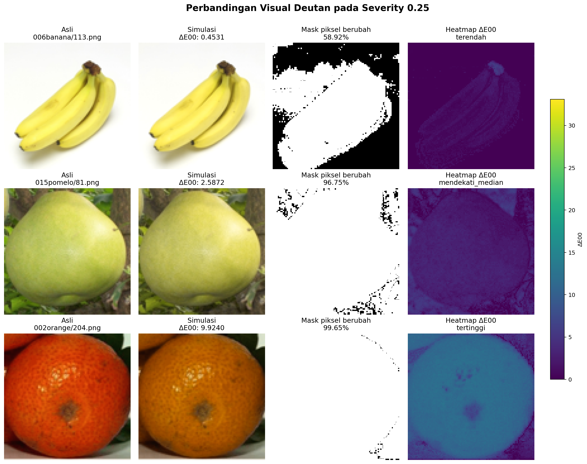
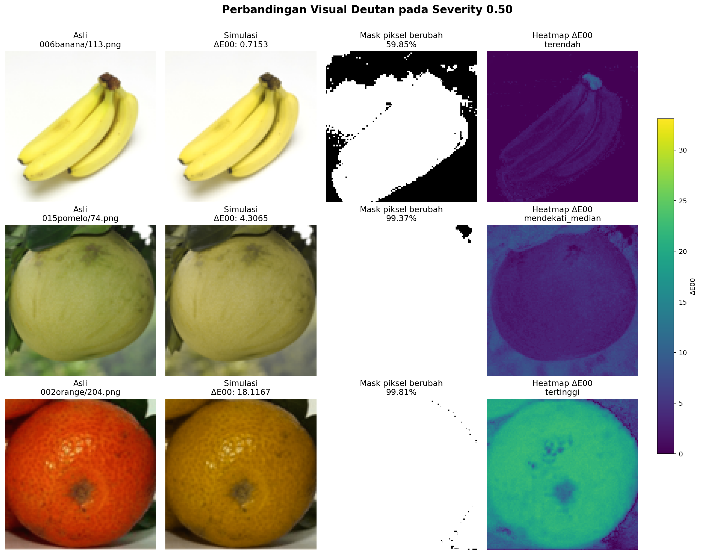
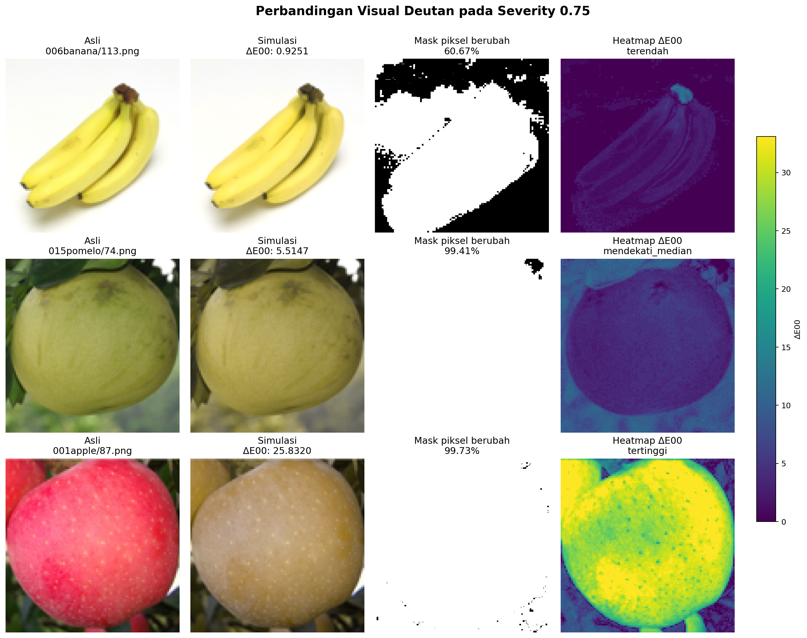
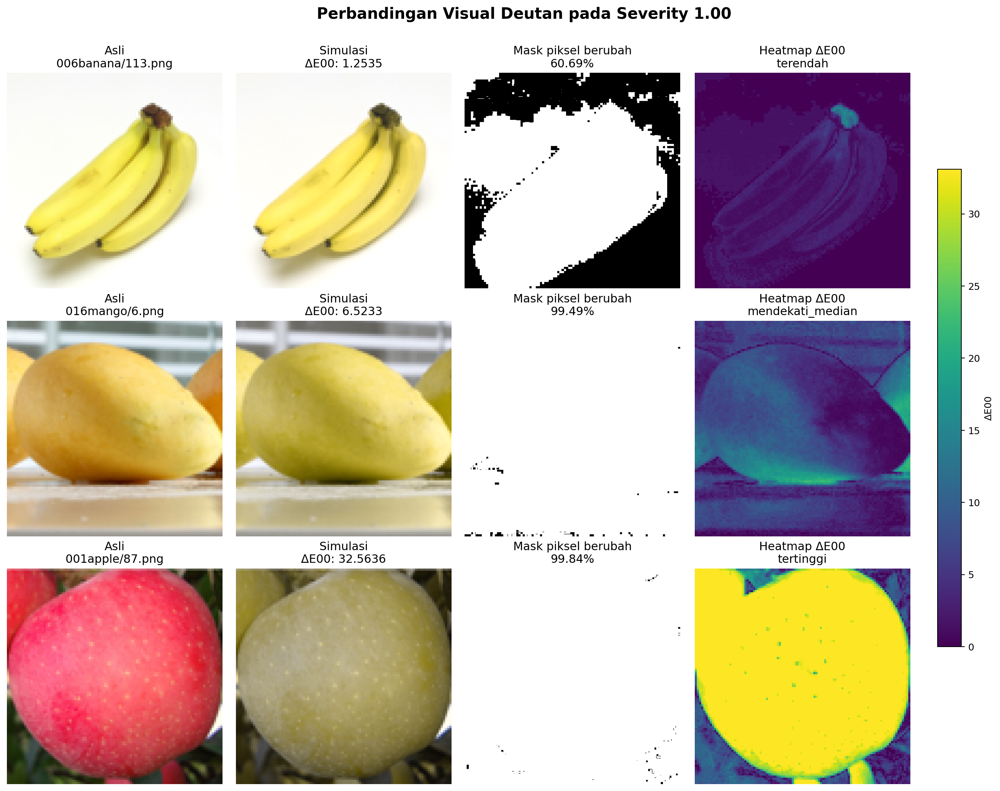
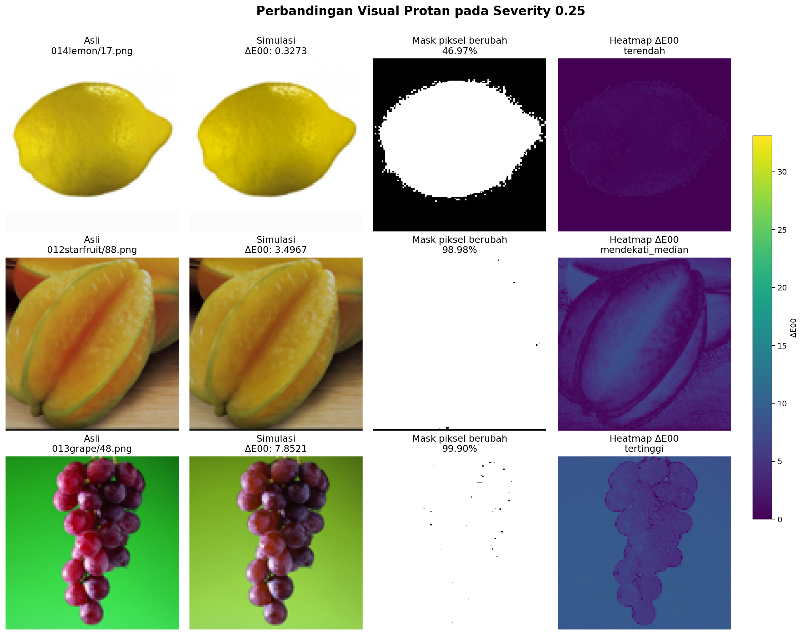
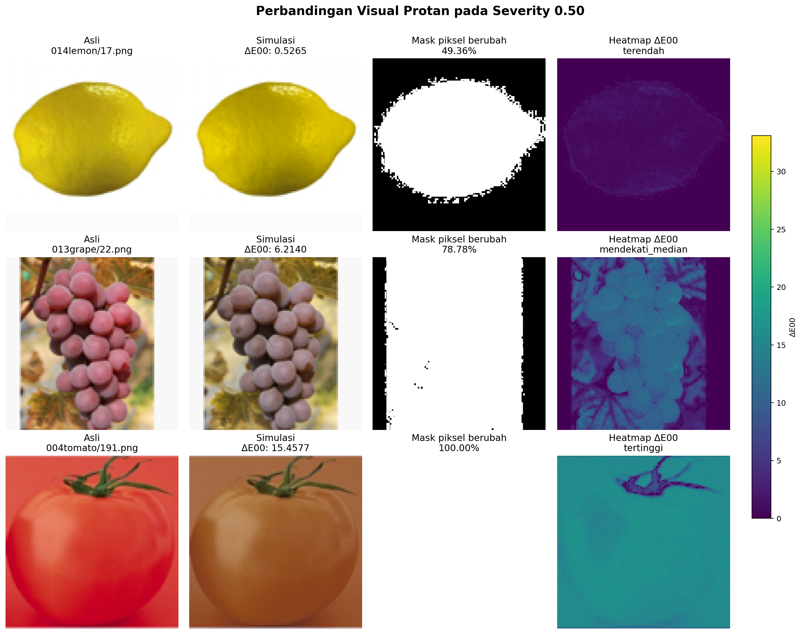
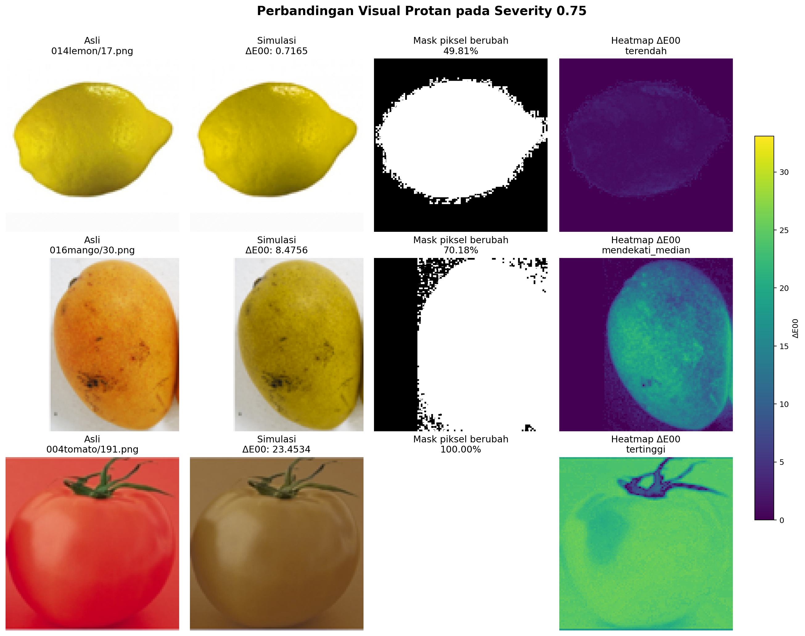
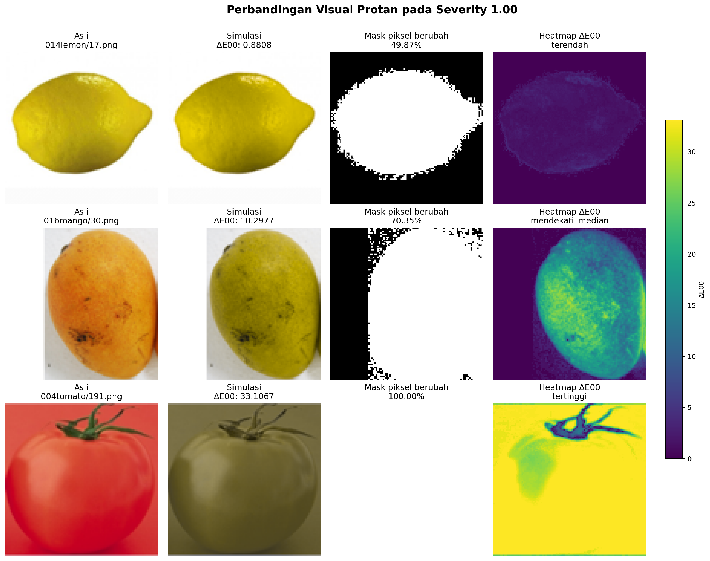

# Analisis Hasil NB03: Evaluasi dan Visualisasi Perbedaan Warna CIEDE2000

## Alur Penelitian

NB03 mengevaluasi 2.100 pasangan protan dan 2.100 pasangan deutan, empat severity untuk masing-masing 525 citra per tipe. Nilai $\Delta E_{00}$ dihitung pada seluruh citra, termasuk latar. Totalnya 4.200 evaluasi.

Output aktif mencakup ringkasan individu, kelas, kelompok seleksi, global, 24 kasus representatif, grafik severity, delapan panel, dan perbandingan berpasangan pada 101 sumber yang sama. Ringkasan utama antartipe menggunakan kelompok lengkap yang berbeda komposisi; hasil berpasangan menjawab perbandingan pada subset irisan.

---

## Landasan Teori, Persamaan Matematis, dan Formulasi CIEDE2000

### 1. Transformasi Kolorimetris sRGB ke CIELAB
Setiap pasangan citra digital (asli $I$ dan simulasi $S$) dikonversi dari representasi sRGB non-linear ke ruang warna CIELAB yang mendekati keseragaman perseptual ($L^*, a^*, b^*$) melalui ruang antara CIEXYZ dengan standar iluminan D65 ($X_n = 95{,}047, Y_n = 100{,}000, Z_n = 108{,}883$):

\[
L^* = 116 f(Y/Y_n) - 16, \quad a^* = 500 [f(X/X_n) - f(Y/Y_n)], \quad b^* = 200 [f(Y/Y_n) - f(Z/Z_n)]
\]

dengan fungsi transfer non-linear:

\[
f(t) = 
\begin{cases} 
t^{1/3}, & \text{jika } t > \left(\frac{6}{29}\right)^3 \\
\frac{1}{3}\left(\frac{29}{6}\right)^2 t + \frac{4}{29}, & \text{jika } t \le \left(\frac{6}{29}\right)^3
\end{cases}
\]

### 2. Formulasi Standar Metrik CIEDE2000
Metrik CIEDE2000 diimplementasikan berdasarkan standar resmi CIE dan formulasi komputasional terverifikasi dari:
> **Sharma, G., Wu, W., & Dalal, E. N. (2005).** *The CIEDE2000 color-difference formula: Implementation notes, supplementary test data, and mathematical observations.* Color Research & Application, 30(1), 21-30. [DOI: 10.1002/col.20070](https://doi.org/10.1002/col.20070).

Dua sampel warna dalam CIELAB, $(L^*_1, a^*_1, b^*_1)$ dan $(L^*_2, a^*_2, b^*_2)$, dievaluasi melalui tahapan:

#### a. Modifikasi Sumbu $a^*$ untuk Koreksi Kroma Rendah
Kromatisitas $C^*_{ab} = \sqrt{a^{*2} + b^{*2}}$ dirata-ratakan ($\overline{C}^*_{ab} = (C^*_{ab,1} + C^*_{ab,2})/2$), lalu faktor pembobot $G$ dihitung untuk meregangkan sumbu $a^*$ pada wilayah mendekati netral:

\[
G = 0{,}5 \left( 1 - \sqrt{\frac{\overline{C}^{*7}_{ab}}{\overline{C}^{*7}_{ab} + 25^7}} \right)
\]
\[
a'_i = (1 + G)a^*_i, \quad C'_i = \sqrt{a^{'2}_i + b^{*2}_i}, \quad h'_i = \text{atan2}(b^*_i, a'_i) \pmod{360^\circ}
\]

#### b. Selisih Metrik Komponen Luminansi, Kroma, dan Rona
Selisih dihitung sebagai:

\[
\Delta L' = L^*_2 - L^*_1, \quad \Delta C' = C'_2 - C'_1, \quad \Delta H' = 2\sqrt{C'_1 C'_2}\sin\left(\frac{\Delta h'}{2}\right)
\]

dengan $\Delta h' = h'_2 - h'_1$ yang dikoreksi ke rentang $[-180^\circ, 180^\circ]$.

#### c. Fungsi Pembobotan Posisi ($S_L, S_C, S_H$) dan Faktor Interaksi Rotasi ($R_T$)
Bobot penyesuaian non-seragam elips diskriminasi warna dihitung melalui:

\[
S_L = 1 + \frac{0{,}015(\overline{L}' - 50)^2}{\sqrt{20 + (\overline{L}' - 50)^2}}, \quad S_C = 1 + 0{,}045\overline{C}', \quad S_H = 1 + 0{,}015\overline{C}' T
\]

dengan faktor harmonik rona $T$:

\[
T = 1 - 0{,}17\cos(\overline{h}' - 30^\circ) + 0{,}24\cos(2\overline{h}') + 0{,}32\cos(3\overline{h}' + 6^\circ) - 0{,}20\cos(4\overline{h}' - 63^\circ)
\]

Interaksi rotasi elips pada wilayah biru dihitung melalui faktor $R_T$:

\[
R_T = -\sin(2\Delta\theta) R_C, \quad \Delta\theta = 30^\circ \exp\left( -\left[\frac{\overline{h}' - 275^\circ}{25^\circ}\right]^2 \right), \quad R_C = 2\sqrt{\frac{\overline{C}^{'7}}{\overline{C}^{'7} + 25^7}}
\]

#### d. Nilai Total Perbedaan Warna $\Delta E^*_{00}$
Dengan faktor parametrik standar $k_L = k_C = k_H = 1$ (kondisi pengamatan referensi CIE):

\[
\Delta E^*_{00} = \sqrt{\left(\frac{\Delta L'}{k_L S_L}\right)^2 + \left(\frac{\Delta C'}{k_C S_C}\right)^2 + \left(\frac{\Delta H'}{k_H S_H}\right)^2 + R_T\left(\frac{\Delta C'}{k_C S_C}\right)\left(\frac{\Delta H'}{k_H S_H}\right)}
\]

Untuk setiap pasangan citra $H \times W$ piksel ($512 \times 512 = 262.144$ piksel), metrik agregasi tingkat citra dihitung melalui rata-rata spasial (*spatial pooling mean*):

\[
\overline{\Delta E}_{00}(I, S) = \frac{1}{HW} \sum_{x=1}^{W}\sum_{y=1}^{H} \Delta E^*_{00}(I(x,y), S(x,y))
\]

Implementasi memakai `skimage.color.deltaE_ciede2000`, termasuk aturan selisih dan rerata sudut serta kasus kroma nol. Persamaan di atas adalah ringkasan; pada pasangan akromatik, aturan khusus tetap diperlukan. Referensi implementasi dan data uji tersedia pada [halaman penulis Sharma, Wu, dan Dalal](https://hajim.rochester.edu/ece/sites/gsharma/ciede2000/).

OpenCV mengonversi BGR uint8 ke Lab, kemudian kode memetakan L ke 0-100 dan mengurangi kanal a serta b dengan 128. Konversi 8-bit mengandung kuantisasi. Rata-rata mencakup seluruh piksel, termasuk latar. Mask foreground NB01 tidak membatasi evaluasi NB03. Rata-rata spasial merupakan ringkasan operasional citra, bukan bagian tambahan formula CIEDE2000.

---

## Hasil Evaluasi 4 Level Hierarkis (Tabel Pembantu Bab 5)

### 1. Level 4: Ringkasan Kondisi Global (Global / Kondisi Simulasi)

| Tipe | Severity | Citra | Mean $\Delta E_{00}$ | Median | Minimum | Maksimum |
| --- | ---: | ---: | ---: | ---: | ---: | ---: |
| deutan | 0,25 | 525 | 3,1308 | 2,5872 | 0,4531 | 9,9240 |
| deutan | 0,50 | 525 | 5,4000 | 4,3065 | 0,7153 | 18,1167 |
| deutan | 0,75 | 525 | 7,0347 | 5,5147 | 0,9251 | 25,8320 |
| deutan | 1,00 | 525 | 8,3358 | 6,5233 | 1,2535 | 32,5636 |
| protan | 0,25 | 525 | 3,4659 | 3,4967 | 0,3273 | 7,8521 |
| protan | 0,50 | 525 | 6,3369 | 6,2140 | 0,5265 | 15,4577 |
| protan | 0,75 | 525 | 8,8814 | 8,4756 | 0,7165 | 23,4534 |
| protan | 1,00 | 525 | 11,5018 | 10,2977 | 0,8808 | 33,1067 |

Mean Delta E00 meningkat bersama severity pada kedua tipe. Rata-rata global seluruh 4.200 evaluasi adalah 6,7609 dengan simpangan baku 5,2709. Nilai minimum seluruh evaluasi 0,3273 dan maksimum 33,1067. Statistik ini mengukur perubahan warna seluruh citra, termasuk latar, sesuai konfigurasi notebook.

### 2. Level 3: Ringkasan Kelompok Seleksi Confusion Line

Terdapat satu kelompok seleksi untuk setiap tipe, `confusion_line_protan` dan `confusion_line_deutan`, masing-masing berisi 525 citra pada setiap severity. Karena hanya satu kelompok seleksi per tipe, ringkasannya sama dengan baris global untuk tipe-severity yang sama. Kelompok lengkap ini memiliki komposisi kelas yang berbeda, sehingga selisih protan-deutan pada tabel bukan efek tipe yang terisolasi.

### 3. Level 2: Ringkasan Tingkat Kelas Buah pada Kondisi Ekstrem (Severity 1,00)

Berikut mean kelas dengan nilai tertinggi dan terendah pada severity 1,00. Jumlah citra per kelas dicantumkan karena jumlah akhir protan per kelas tidak seragam setelah penyeimbangan antar-tipe.

| Tipe | Kelas | Jumlah citra | Mean $\Delta E_{00}$ |
| --- | --- | ---: | ---: |
| protan | 003pear | 28 | 3,8275 |
| protan | 004tomato | 34 | 22,0063 |
| deutan | 006banana | 35 | 3,4796 |
| deutan | 001apple | 35 | 19,5240 |

Tabel ini menunjukkan rentang dua ujung mean kelas, bukan seluruh distribusi. Nilai kelas dipengaruhi citra dan latar yang masuk ke kelompok; hasilnya tidak langsung menyatakan tingkat kesulitan pengenalan buah oleh manusia.

## Analisis Mendalam Hubungan Antar-Variabel: Apa, Mengapa, Akibat, dan Bagaimana

### 1. Hubungan antara Severity dan Nilai $\Delta E_{00}$ Global

Mean meningkat dari severity 0,25 ke 1,00 pada kedua tipe. Perubahan mean antara kedua tingkat itu adalah 5,2050 untuk deutan dan 8,0358 untuk protan. Median juga meningkat. Tren tersebut konsisten dengan semakin kuatnya transformasi simulasi, tetapi bukan ukuran prevalensi atau dampak klinis.

### 2. Variasi Sampel dan Kontribusi Latar

Metrik dihitung pada seluruh piksel. Warna buah dan latar sama-sama berkontribusi, sehingga citra berlatar berwarna dapat memiliki perubahan besar meskipun objek buah tidak berubah dengan besaran sama. NB01 memakai mask untuk ekstraksi warna saat seleksi; mask tersebut tidak diterapkan pada evaluasi CIEDE2000 di NB03.

### 3. Komparasi Karakteristik Deutan vs Protan

Pada kelompok lengkap, mean protan lebih tinggi pada severity 0,25, 0,50, 0,75, dan 1,00. Perbandingan ini deskriptif karena kelas protan dan deutan berbeda sebagian. Untuk membandingkan citra yang sama, digunakan 101 sumber yang berada pada irisan kedua kelompok.

| Severity | Pasangan citra | Mean protan | Mean deutan | Selisih deutan - protan | Median selisih |
| ---: | ---: | ---: | ---: | ---: | ---: |
| 0,25 | 101 | 2,5707 | 2,8078 | 0,2372 | 0,1046 |
| 0,50 | 101 | 4,4834 | 4,7745 | 0,2911 | 0,1380 |
| 0,75 | 101 | 5,9953 | 6,1418 | 0,1465 | 0,0308 |
| 1,00 | 101 | 7,3073 | 7,2371 | -0,0702 | -0,0365 |

Pada subset berpasangan, deutan memiliki mean lebih tinggi pada tiga severity pertama, sedangkan protan sedikit lebih tinggi pada severity 1,00. Selisihnya kecil dibanding variasi antar-citra dan tidak disertai uji signifikansi pada laporan ini. Karena itu, hasil tidak mendukung klaim bahwa satu tipe selalu menghasilkan Delta E00 lebih tinggi.

---

## Kasus Representatif (Level 1: Per Individu)

| Tipe | Severity | Kasus | Kelas / Berkas | Mean $\Delta E_{00}$ |
| --- | ---: | --- | --- | ---: |
| deutan | 0,25 | terendah | `006banana/113.png` | 0,4531 |
| deutan | 0,25 | mendekati_median | `015pomelo/81.png` | 2,5872 |
| deutan | 0,25 | tertinggi | `002orange/204.png` | 9,9240 |
| deutan | 0,50 | terendah | `006banana/113.png` | 0,7153 |
| deutan | 0,50 | mendekati_median | `015pomelo/74.png` | 4,3065 |
| deutan | 0,50 | tertinggi | `002orange/204.png` | 18,1167 |
| deutan | 0,75 | terendah | `006banana/113.png` | 0,9251 |
| deutan | 0,75 | mendekati_median | `015pomelo/74.png` | 5,5147 |
| deutan | 0,75 | tertinggi | `001apple/87.png` | 25,8320 |
| deutan | 1,00 | terendah | `006banana/113.png` | 1,2535 |
| deutan | 1,00 | mendekati_median | `016mango/6.png` | 6,5233 |
| deutan | 1,00 | tertinggi | `001apple/87.png` | 32,5636 |
| protan | 0,25 | terendah | `014lemon/17.png` | 0,3273 |
| protan | 0,25 | mendekati_median | `012starfruit/88.png` | 3,4967 |
| protan | 0,25 | tertinggi | `013grape/48.png` | 7,8521 |
| protan | 0,50 | terendah | `014lemon/17.png` | 0,5265 |
| protan | 0,50 | mendekati_median | `013grape/22.png` | 6,2140 |
| protan | 0,50 | tertinggi | `004tomato/191.png` | 15,4577 |
| protan | 0,75 | terendah | `014lemon/17.png` | 0,7165 |
| protan | 0,75 | mendekati_median | `016mango/30.png` | 8,4756 |
| protan | 0,75 | tertinggi | `004tomato/191.png` | 23,4534 |
| protan | 1,00 | terendah | `014lemon/17.png` | 0,8808 |
| protan | 1,00 | mendekati_median | `016mango/30.png` | 10,2977 |
| protan | 1,00 | tertinggi | `004tomato/191.png` | 33,1067 |

Setiap kondisi menampilkan kasus terendah, mendekati median, dan tertinggi. Contoh dipakai untuk menafsirkan visual; ringkasan kelas dan kelompok tetap dihitung dari seluruh data.

---

## Visualisasi Severity

Mean meningkat pada kedua kurva. Protan memiliki nilai rata-rata lebih tinggi pada kelompok lengkap di semua severity. Karena kedua kelompok tidak sepenuhnya berisi citra yang sama, kurva ini bukan perbandingan berpasangan. Grafik `paired_mean_delta_e00_by_condition.png` merangkum 101 sumber yang sama dan menunjukkan pola selisih yang berbeda.

---

## Penjelasan Setiap Visual Aktif (8 Panel Komparatif)

Setiap panel memuat citra asli, simulasi, mask piksel berubah, dan heatmap $\Delta E_{00}$. Mask putih menandai piksel yang berubah secara numerik; mask ini bukan segmentasi foreground dan bukan ambang persepsi. Heatmap dihitung pada seluruh gambar termasuk latar.

### 1. Panel Visual Deutan

#### Severity 0,25

Kasus terendah `006banana/113.png` memiliki mean 0,4531, pomelo `015pomelo/81.png` mendekati median dengan 2,5872, dan orange `002orange/204.png` tertinggi dengan 9,9240. Pada contoh orange, buah menjadi lebih kuning-cokelat; bagian latar turut berubah.

#### Severity 0,50

Banana tetap terendah (0,7153), pomelo `015pomelo/74.png` mendekati median (4,3065), dan orange `002orange/204.png` tertinggi (18,1167). Pada sumber orange yang sama, perubahan heatmap lebih besar daripada severity 0,25.

#### Severity 0,75

Banana menjadi contoh terendah (0,9251), pomelo mendekati median (5,5147), dan apple `001apple/87.png` tertinggi (25,8320). Warna merah muda apel tampak lebih netral kecokelatan dan sebagian besar area buah menunjukkan perubahan.

#### Severity 1,00

Banana memiliki mean terendah (1,2535), mango `016mango/6.png` mendekati median (6,5233), dan apple `001apple/87.png` tertinggi (32,5636). Area buah dan latar sama-sama menyumbang heatmap pada contoh ini.

### 2. Panel Visual Protan

#### Severity 0,25

Lemon `014lemon/17.png` memiliki mean terendah (0,3273), starfruit `012starfruit/88.png` mendekati median (3,4967), dan grape `013grape/48.png` tertinggi (7,8521). Latar hijau pada citra grape ikut berubah dan berkontribusi pada nilai seluruh gambar.

#### Severity 0,50

Lemon tetap terendah (0,5265), grape `013grape/22.png` mendekati median (6,2140), dan tomato `004tomato/191.png` tertinggi (15,4577). Tomato tampak bergeser ke cokelat; latar merah di sekitarnya juga berubah.

#### Severity 0,75

Lemon memiliki mean terendah (0,7165), mango `016mango/30.png` mendekati median (8,4756), dan tomato `004tomato/191.png` tertinggi (23,4534). Perubahan tomato meningkat pada sumber yang sama dibanding severity sebelumnya.

#### Severity 1,00

Lemon tetap memiliki mean terendah (0,8808), mango `016mango/30.png` mendekati median (10,2977), dan tomato `004tomato/191.png` tertinggi (33,1067). Tomato dan latar tampak lebih gelap serta zaitun-cokelat.

---

## Artefak Aktif

| Berkas Keluaran | Makna |
| --- | --- |
| [evaluation_individual.csv](output/evaluation_individual.csv) | Evaluasi per citra, tipe, dan severity. |
| [evaluation_class_summary.csv](output/evaluation_class_summary.csv) | Ringkasan per kelas. |
| [evaluation_selection_summary.csv](output/evaluation_selection_summary.csv) | Ringkasan per kelompok seleksi. |
| [evaluation_global_summary.csv](output/evaluation_global_summary.csv) | Ringkasan global tipe-severity. |
| [evaluation_paired_images.csv](output/evaluation_paired_images.csv) | Hasil berpasangan per citra yang muncul di kedua tipe. |
| [evaluation_paired_summary.csv](output/evaluation_paired_summary.csv) | Ringkasan berpasangan per severity. |
| [evaluation_summary.json](output/evaluation_summary.json) | Metadata run, jumlah evaluasi, dan batas ruang metrik. |
| [representative_cases.csv](output/representative_cases.csv) | 24 kasus visual terpilih. |
| [mean_delta_e00_by_condition.png](output/mean_delta_e00_by_condition.png) | Kurva mean kelompok lengkap. |
| [paired_mean_delta_e00_by_condition.png](output/paired_mean_delta_e00_by_condition.png) | Perbandingan mean pada sumber yang sama. |
| [figures/](output/figures/) | Delapan panel asli, simulasi, mask, dan heatmap. |

---

## Kesimpulan dan Keterkaitan Lintas Notebook

NB01 menghasilkan 525 citra per tipe setelah penyeimbangan jumlah total protan dan deutan. NB02 memproses semuanya pada empat severity, menghasilkan 4.200 citra simulasi. NB03 menunjukkan kenaikan mean Delta E00 seiring severity pada kedua tipe.

Pada kelompok lengkap, mean protan lebih tinggi pada setiap severity, tetapi komposisi kelas berbeda. Pada 101 sumber yang sama, mean deutan sedikit lebih tinggi pada tiga tingkat awal dan protan sedikit lebih tinggi pada tingkat tertinggi. Hasil ini bersifat deskriptif dan mengukur perbedaan warna menurut model pada seluruh citra, termasuk latar. Tanpa validasi peserta CVD, nilai tersebut bukan bukti langsung tentang kemampuan pengenalan buah manusia.

