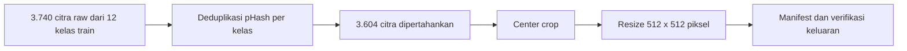
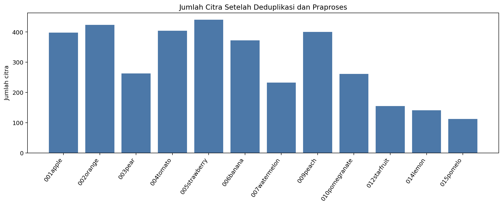

# Analisis Hasil NB01: Praproses Dataset

## Alur penelitian

NB01 menyiapkan data yang akan digunakan secara seragam pada tahap simulasi. Tahap ini tidak menilai atau mengelompokkan warna citra. Seluruh citra dari 12 kelas terpilih pada subset `train` dipertahankan selama dapat diproses dan bukan duplikat visual menurut aturan pHash yang ditetapkan.

## Tahapan dan hasil

### Inventarisasi data sumber

Dataset awal memuat 3.740 citra dari 12 kelas. Jumlah citra tidak sama pada setiap kelas. `005strawberry` memiliki 450 citra sebelum deduplikasi, sedangkan `015pomelo` memiliki 118 citra. Perbedaan ini berasal dari komposisi dataset sumber dan tidak diubah melalui penyeimbangan buatan.

### Deduplikasi intra-kelas

Deduplikasi dilakukan dalam kelas yang sama menggunakan *perceptual hash* berbasis DCT. Dua citra diperlakukan sebagai duplikat apabila jarak Hamming hash tidak melebihi 4. Aturan ini digunakan untuk mengurangi pengulangan visual tanpa membandingkan buah dari kelas yang berbeda.

Sebanyak 136 citra, atau 3,64% dari data awal, ditandai sebagai duplikat. Dengan demikian, 3.604 citra diteruskan ke tahap praproses. Penghapusan terbanyak terjadi pada `009peach`, yaitu 34 citra, diikuti `006banana` sebanyak 22 citra dan `001apple` sebanyak 20 citra. Keputusan setiap pasangan tetap tersimpan dalam `deduplication_report.csv`, sehingga hasilnya dapat diperiksa kembali.

pHash dipilih karena membandingkan struktur visual secara ringkas, bukan kesamaan piksel secara persis. Jarak Hamming yang digunakan adalah

\[
d_H(a,b)=\sum_j \mathbf{1}[a_j\ne b_j].
\]

Ambang 4 merupakan parameter penelitian, bukan batas universal bahwa dua citra pasti sama. Oleh sebab itu, deduplikasi hanya dimaknai sebagai pengurangan pengulangan visual dalam dataset.

### Center crop dan resize

Setiap citra yang dipertahankan dipotong dari bagian tengah berdasarkan sisi terpendek, lalu diubah menjadi 512 x 512 piksel. *Center crop* menjaga rasio aspek agar objek tidak diregangkan, sedangkan ukuran yang seragam membuat jumlah piksel dan biaya komputasi pada NB02 konsisten. Konsekuensinya, bagian objek yang sangat dekat dengan tepi citra dapat tidak ikut tersimpan.

Seluruh 3.604 keluaran dapat dibaca kembali dan memiliki ukuran 512 x 512 piksel. Tidak ada kesalahan praproses yang tercatat pada `dataset_preparation_errors.csv`.

## Ringkasan hasil

| Keterangan | Nilai |
|---|---:|
| Kelas sumber | 12 |
| Subset yang digunakan | `train` |
| Citra sebelum deduplikasi | 3.740 |
| Duplikat dihapus | 136 |
| Citra setelah praproses | 3.604 |
| Tingkat penghapusan duplikat | 3,64% |
| Ukuran keluaran | 512 x 512 piksel |
| Kesalahan praproses | 0 |

Gambar tersebut memperlihatkan jumlah citra akhir pada setiap kelas. Tinggi batang tidak digunakan untuk membandingkan mutu kelas atau hasil simulasi. Grafik hanya menunjukkan komposisi data yang menjadi dasar perhitungan agregat pada NB02 dan NB03. Karena jumlah citra antarkelas berbeda, rata-rata seluruh dataset merupakan rata-rata berbobot oleh jumlah citra yang tersedia.

## Artefak aktif

| Output | Makna |
|---|---|
| `dataset_preparation_report.csv` | Manifest 3.604 citra yang menjadi masukan resmi NB02. |
| `deduplication_report.csv` | Berkas yang ditandai sebagai duplikat serta wakil yang dipertahankan. |
| `dataset_preparation_verification.csv` | Pemeriksaan keterbacaan dan ukuran keluaran. |
| `dataset_preparation_errors.csv` | Catatan kesalahan praproses, kosong pada run aktif. |
| `dataset_preparation_summary.json` | Ringkasan jumlah data dan parameter utama. |
| `dataset_preparation_summary.png` | Jumlah citra akhir pada tiap kelas. |

Folder atau artefak lama tidak digunakan dalam analisis ini.

## Penjelasan visual aktif

### Grafik jumlah citra setelah praproses

Grafik memperlihatkan jumlah citra yang tersisa untuk setiap kelas setelah deduplikasi dan praproses. Batang tertinggi adalah `005strawberry` dengan 441 citra, diikuti `002orange` dengan 424 citra, `004tomato` dengan 404 citra, dan `009peach` dengan 400 citra. Batang terendah adalah `015pomelo` dengan 112 citra, `014lemon` dengan 141 citra, serta `012starfruit` dengan 155 citra. Perbedaan tinggi batang menunjukkan jumlah data akhir yang memang tersedia pada dataset, bukan hasil penilaian terhadap kesulitan simulasi atau kualitas visual tiap kelas.

Grafik juga memperlihatkan bahwa deduplikasi tidak menghilangkan satu kelas pun. Semua 12 kelas tetap memiliki lebih dari 100 citra setelah proses. Dengan demikian, NB02 menerima data yang mencakup seluruh kelas sumber. Namun, jumlah citra yang tidak seimbang berarti nilai rata-rata seluruh dataset memberi bobot lebih besar kepada kelas dengan jumlah citra lebih banyak. Analisis NB03 karena itu menyajikan statistik untuk semua citra dan tidak menyatakan bahwa satu kelas tertentu mewakili keseluruhan dataset.
