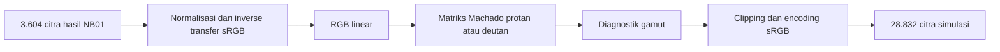
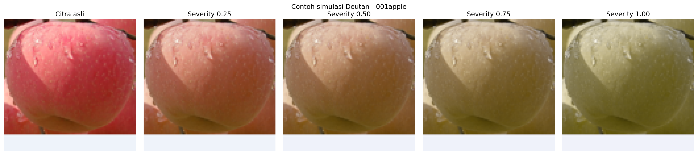
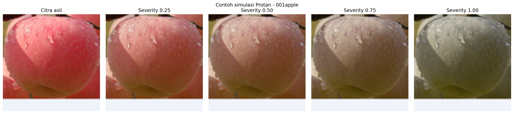

# Analisis Hasil NB02: Simulasi Buta Warna Parsial

## Alur penelitian

NB02 menerapkan model Machado pada seluruh citra hasil NB01. Setiap citra diproses pada protan dan deutan, masing-masing pada severity 0,25; 0,50; 0,75; dan 1,00. Dengan demikian, setiap citra menghasilkan delapan kondisi simulasi.

## Proses simulasi

Citra yang dibaca oleh OpenCV berada pada urutan BGR. Sebelum transformasi, kanal diubah ke RGB dan dinormalisasi ke rentang 0 sampai 1. Nilai sRGB kemudian dilinearkan agar matriks Machado bekerja pada RGB linear. Bentuk transformasinya adalah

\[
\mathbf{c}'_{lin}=\Gamma_{CVD}(s)\mathbf{c}_{lin}.
\]

Untuk severity yang berada di antara dua tabel matriks, matriks diinterpolasi secara linear. Setelah transformasi, nilai RGB linear yang berada di luar rentang 0 sampai 1 dicatat sebagai clipping, dibatasi ke rentang tampilan, lalu dikodekan kembali ke sRGB dan disimpan sebagai PNG.

Model Machado mengubah representasi warna, bukan bentuk atau lokasi objek. Karena itu, struktur spasial citra tetap berada pada posisi yang sama; perubahan yang diamati pada tahap berikutnya terutama berasal dari transformasi warna dan pembatasan gamut.

## Hasil simulasi

Sebanyak 3.604 citra menghasilkan 28.832 citra simulasi, sesuai perhitungan \(3.604 \times 2 \times 4\). Tidak ada kesalahan pada `simulation_errors.csv`. Setiap kondisi memuat 3.604 hasil.

| Tipe | Severity | Rata-rata perubahan RGB | Piksel berubah | Clipping |
|---|---:|---:|---:|---:|
| Deutan | 0,25 | 0,0290 | 88,48% | 16,96% |
| Deutan | 0,50 | 0,0458 | 92,60% | 18,24% |
| Deutan | 0,75 | 0,0571 | 93,54% | 15,37% |
| Deutan | 1,00 | 0,0655 | 94,26% | 18,11% |
| Protan | 0,25 | 0,0267 | 92,39% | 20,84% |
| Protan | 0,50 | 0,0445 | 94,18% | 23,87% |
| Protan | 0,75 | 0,0580 | 94,48% | 22,38% |
| Protan | 1,00 | 0,0700 | 94,54% | 26,12% |

Rata-rata perubahan RGB meningkat pada kedua tipe simulasi ketika severity bertambah. Pada severity 1,00, protan memiliki perubahan RGB rata-rata 0,0700, sedikit lebih tinggi daripada deutan sebesar 0,0655. Angka ini menunjukkan perbedaan nilai kanal setelah simulasi, bukan besar perubahan perseptual. Karena itu, interpretasi utama perubahan warna tetap menggunakan ?E00 pada NB03.

Proporsi piksel berubah juga meningkat, tetapi tidak selalu sebanding dengan besar perubahan. Sebagai contoh, banyak piksel dapat berubah hanya satu tingkat nilai uint8 dan tetap dihitung sebagai piksel berubah. Clipping tidak meningkat secara monoton, karena posisi nilai hasil transformasi terhadap batas gamut dapat berubah berbeda pada tiap citra dan kanal. Clipping digunakan sebagai diagnostik pembatasan gamut, bukan sebagai skor kualitas simulasi.

## Visualisasi severity

Gambar simulasi deutan memperlihatkan citra contoh yang sama pada empat severity. Semakin tinggi severity, warna berubah semakin jauh dari citra asal karena matriks aktif semakin berbeda dari matriks identitas. Gambar ini menjelaskan arah visual perubahan dalam satu citra, tetapi tidak mewakili seluruh kelas atau seluruh dataset.

Gambar simulasi protan menunjukkan prinsip yang sama dengan koefisien matriks berbeda. Perbedaan antara protan dan deutan tidak boleh disimpulkan hanya dari satu contoh gambar. Perbandingan populasi dilakukan pada NB03 melalui rata-rata ?E00 seluruh citra di setiap kondisi.

## Artefak aktif

| Output | Makna |
|---|---|
| `simulated_images/` | 28.832 citra hasil simulasi. |
| `simulation_report.csv` | Identitas input-output dan diagnostik tiap citra-kondisi. |
| `simulation_group_summary.csv` | Rata-rata perubahan RGB, piksel berubah, dan clipping untuk delapan kondisi. |
| `simulation_verification.csv` | Pemeriksaan keterbacaan keluaran simulasi. |
| `simulation_errors.csv` | Catatan kesalahan simulasi, kosong pada run aktif. |
| `simulation_summary.json` | Ringkasan jumlah citra dan konfigurasi. |
| `simulation_severity_deutan.png` | Contoh visual empat severity deutan. |
| `simulation_severity_protan.png` | Contoh visual empat severity protan. |

Folder atau artefak lama tidak digunakan dalam analisis ini.

## Penjelasan setiap visual aktif

### Perbandingan severity deutan

Gambar menampilkan satu citra sumber yang sama dari kelas `001apple`, diikuti empat keluaran deutan pada severity 0,25, 0,50, 0,75, dan 1,00. Susunan ini penting karena hanya parameter severity yang berubah; objek, latar, ukuran, dan posisi piksel tetap sama. Pada severity 0,25, perubahan masih relatif terbatas. Perubahan menjadi lebih mudah terlihat pada 0,50 dan 0,75, kemudian paling kuat pada 1,00. Urutan tersebut memperlihatkan bahwa severity bekerja sebagai tingkat kekuatan transformasi Machado, bukan sebagai pilihan filter visual yang tidak berkaitan.

Citra apel dipakai sebagai ilustrasi proses karena merupakan berkas pertama pada manifest setelah pengurutan nama kelas dan nama file. Gambar ini tidak dipilih berdasarkan ?E00 tertinggi dan tidak boleh dipakai sendiri untuk menyimpulkan perilaku seluruh dataset. Besar perubahan populasi deutan dijelaskan oleh statistik NB03, yaitu rata-rata ?E00 yang naik dari 4,9074 pada severity 0,25 menjadi 14,3283 pada severity 1,00.

### Perbandingan severity protan

Gambar protan menggunakan citra sumber yang sama agar perbedaan dengan panel deutan dapat dilihat pada objek yang identik. Keempat hasil kembali menunjukkan perubahan bertahap ketika severity meningkat. Walaupun kedua panel menggunakan titik severity yang sama, warna hasil protan tidak identik dengan deutan karena koefisien matriks Machado untuk kedua tipe berbeda.

Gambar ini terutama menunjukkan perubahan arah visual pada citra contoh, bukan ukuran perubahan rata-rata. Pada seluruh dataset, rata-rata perubahan RGB protan meningkat dari 0,0267 menjadi 0,0700. Sebaliknya, ?E00 rata-rata protan meningkat dari 3,8876 menjadi 13,5894. Kedua metrik perlu dibedakan: perubahan RGB menyatakan selisih numerik kanal, sedangkan ?E00 digunakan pada NB03 untuk menjelaskan besar perubahan warna dalam ruang CIELAB.
