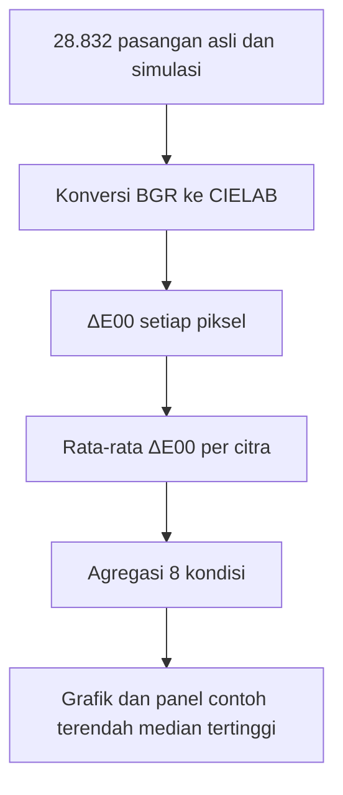

# Analisis Hasil NB03: Evaluasi dan Visualisasi Perubahan Warna

## Alur penelitian

NB03 bertujuan untuk menghitung perbedaan warna (ΔE00) antara citra hasil praproses NB01 dan delapan kondisi simulasi NB02 menggunakan formula standar CIEDE2000. Hasil evaluasi menjelaskan besar perubahan warna pada dataset, bukan validitas klinis persepsi setiap individu dengan buta warna parsial.

Setiap pasangan citra dikonversi ke CIELAB sebelum dihitung perbedaan warnanya. Rata-rata nilai per piksel ditulis sebagai

\[
\overline{\Delta E}_{00}=\frac{1}{HW}\sum_x \Delta E_{00}(Lab(I_x),Lab(S_x)).
\]

Nilai ini digunakan sebagai ukuran deskriptif perubahan warna rata-rata antara citra asli \(I\) dan citra simulasi \(S\).

## Hasil seluruh dataset

Sebanyak 28.832 pasangan citra dievaluasi, yaitu 3.604 citra pada delapan kondisi simulasi. Rata-rata ?E00 global seluruh pasangan adalah 9,3801.

| Tipe | Severity | Jumlah citra | Rata-rata ?E00 | Median | Minimum | Maksimum |
|---|---:|---:|---:|---:|---:|---:|
| Deutan | 0,25 | 3.604 | 4,9074 | 5,3004 | 0,1722 | 11,3854 |
| Deutan | 0,50 | 3.604 | 8,8629 | 9,4448 | 0,4193 | 21,7794 |
| Deutan | 0,75 | 3.604 | 11,9026 | 12,4995 | 0,5514 | 30,1604 |
| Deutan | 1,00 | 3.604 | 14,3283 | 14,9362 | 0,6570 | 36,7073 |
| Protan | 0,25 | 3.604 | 3,8876 | 4,2764 | 0,1777 | 7,8303 |
| Protan | 0,50 | 3.604 | 7,2550 | 7,8963 | 0,5022 | 15,4577 |
| Protan | 0,75 | 3.604 | 10,3078 | 11,1640 | 0,6147 | 23,4534 |
| Protan | 1,00 | 3.604 | 13,5894 | 14,3131 | 0,8491 | 33,4403 |

Berdasarkan grafik dan tabel, rata-rata ?E00 meningkat secara monoton pada kedua tipe simulasi. Pada deutan, rata-rata naik dari 4,9074 pada severity 0,25 menjadi 14,3283 pada severity 1,00. Pada protan, rata-rata naik dari 3,8876 menjadi 13,5894. Pola tersebut sesuai dengan semakin besarnya severity yang diterapkan oleh model Machado.

Pada setiap severity, rata-rata deutan lebih tinggi daripada protan. Selisihnya sebesar 1,0197 pada severity 0,25, 1,6079 pada severity 0,50, 1,5948 pada severity 0,75, dan 0,7389 pada severity 1,00. Temuan ini berlaku untuk komposisi 12 kelas buah yang digunakan pada penelitian ini. Nilai tersebut tidak membuktikan bahwa deutan selalu menghasilkan perubahan lebih besar pada setiap citra atau semua jenis dataset.

## Visualisasi contoh citra

Setiap kondisi memiliki satu panel visual yang memuat tiga contoh citra: ?E00 terendah, nilai yang paling dekat dengan median, dan ?E00 tertinggi. Aturan ini membuat pemilihan contoh dapat ditelusuri dan menghindari pemilihan gambar hanya karena tampak paling menarik.

| Tipe | Severity | Terendah | Mendekati median | Tertinggi |
|---|---:|---:|---:|---:|
| Deutan | 0,25 | `003pear/127.png`, 0,1722 | `009peach/155.png`, 5,3001 | `004tomato/191.png`, 11,3854 |
| Deutan | 0,50 | `003pear/112.png`, 0,4193 | `004tomato/354.png`, 9,4422 | `004tomato/191.png`, 21,7794 |
| Deutan | 0,75 | `003pear/112.png`, 0,5514 | `001apple/224.png`, 12,4993 | `004tomato/191.png`, 30,1604 |
| Deutan | 1,00 | `003pear/112.png`, 0,6570 | `009peach/28.png`, 14,9322 | `004tomato/191.png`, 36,7073 |
| Protan | 0,25 | `006banana/69.png`, 0,1777 | `007watermelon/39.png`, 4,2758 | `002orange/429.png`, 7,8303 |
| Protan | 0,50 | `003pear/112.png`, 0,5022 | `004tomato/355.png`, 7,8985 | `004tomato/191.png`, 15,4577 |
| Protan | 0,75 | `003pear/127.png`, 0,6147 | `009peach/386.png`, 11,1605 | `004tomato/191.png`, 23,4534 |
| Protan | 1,00 | `006banana/329.png`, 0,8491 | `010pomegranate/29.png`, 14,3032 | `005strawberry/318.png`, 33,4403 |

### Deutan

| Severity 0,25 | Severity 0,50 |
|---|---|
|  |  |
| Severity 0,75 | Severity 1,00 |
|  |  |

Pada keempat panel deutan, kolom pertama adalah citra asli, kolom kedua hasil simulasi, kolom ketiga mask piksel berubah, dan kolom keempat heatmap ?E00. Heatmap memakai skala yang sama dalam satu panel. Contoh tertinggi deutan konsisten berasal dari `004tomato/191.png` pada severity 0,50 hingga 1,00. Hal ini menunjukkan citra tersebut berada pada bagian sebaran yang sangat sensitif terhadap transformasi deutan. Contoh terendah didominasi pir, tetapi temuan itu hanya menggambarkan contoh yang dipilih oleh aturan ?E00 dan tidak menjadi label warna atau kategori penelitian.

### Protan

| Severity 0,25 | Severity 0,50 |
|---|---|
|  |  |
| Severity 0,75 | Severity 1,00 |
|  |  |

Panel protan memperlihatkan variasi perubahan antarcitra dalam kondisi yang sama. Pada severity 1,00, contoh terendah `006banana/329.png` memiliki ?E00 0,8491, sedangkan contoh tertinggi `005strawberry/318.png` mencapai 33,4403. Rentang tersebut menjelaskan mengapa rata-rata kelompok perlu dibaca bersama median, minimum, maksimum, dan gambar contoh. Mask putih hanya menunjukkan bahwa sedikitnya satu kanal RGB berubah. Mask tidak menyatakan bahwa seluruh piksel mengalami perubahan perseptual yang besar; besar perubahan dijelaskan oleh heatmap dan ?E00.

## Artefak aktif

| Output | Makna |
|---|---|
| `ciede2000_conformance.csv` | Hasil 34 pasangan acuan CIEDE2000. |
| `image_evaluation_report.csv` | Rata-rata ?E00 setiap pasangan citra. |
| `evaluation_group_summary.csv` | Statistik delapan kondisi simulasi. |
| `representative_cases.csv` | Dasar pemilihan contoh terendah, median, dan tertinggi. |
| `mean_delta_e00_by_condition.png` | Grafik rata-rata ?E00 protan dan deutan menurut severity. |
| `figures/visual_*.png` | Delapan panel citra asli, simulasi, mask, dan heatmap. |
| `evaluation_summary.json` | Ringkasan evaluasi aktif. |

Folder atau artefak lama tidak digunakan dalam analisis ini.

## Kesimpulan

NB03 mengevaluasi 28.832 pasangan citra dan menunjukkan bahwa rata-rata ?E00 meningkat pada empat severity untuk protan maupun deutan. Deutan memiliki rata-rata ?E00 lebih tinggi daripada protan pada kedelapan perbandingan severity yang setara. Panel visual menjelaskan bahwa perubahan tidak seragam antarcitra. Oleh sebab itu, hasil penelitian disimpulkan dari statistik seluruh kondisi, sedangkan gambar contoh digunakan untuk memperlihatkan variasi perubahan yang terdapat di dalamnya.

## Penjelasan setiap visual aktif

### Grafik rata-rata ?E00 menurut tipe dan severity

Grafik memuat dua garis. Garis deutan naik dari 4,9074 pada severity 0,25 menjadi 8,8629, 11,9026, dan 14,3283. Garis protan juga naik dari 3,8876 menjadi 7,2550, 10,3078, dan 13,5894. Kedua garis tidak berpotongan. Artinya, dalam empat titik severity yang diuji dan pada komposisi dataset ini, rata-rata perubahan deutan selalu lebih tinggi daripada protan pada severity yang sama.

Kemiringan kedua garis tidak sama pada setiap interval. Kenaikan deutan terbesar terjadi dari 0,25 ke 0,50, yaitu 3,9556. Kenaikan protan terbesar juga terjadi pada interval pertama, yaitu 3,3674. Setelah itu kenaikan tetap terjadi, tetapi besarnya mengecil. Grafik hanya mendukung pola pada empat titik eksperimen. Ia tidak membuktikan bentuk kurva pada seluruh severity kontinu antara 0 dan 1.

### Panel deutan severity 0,25

Panel ini membandingkan tiga citra pada kondisi deutan severity 0,25. Baris teratas adalah `003pear/127.png` dengan ?E00 0,1722, nilai terendah pada kondisi tersebut. Baris tengah adalah `009peach/155.png` dengan ?E00 5,3001, paling dekat dengan median kelompok 5,3004. Baris bawah adalah `004tomato/191.png` dengan ?E00 11,3854, nilai tertinggi. Perbedaan ketiga baris menunjukkan bahwa satu severity tidak menghasilkan besar perubahan yang sama untuk seluruh citra.

Pada setiap baris, kolom pertama adalah citra asli dan kolom kedua hasil simulasi. Kolom ketiga adalah mask perubahan numerik, sedangkan kolom keempat heatmap ?E00. Area terang pada heatmap menunjukkan lokasi perubahan warna yang lebih besar. Mask putih harus dibaca hati-hati karena satu perubahan kecil pada satu kanal RGB sudah cukup untuk membuat piksel berwarna putih.

### Panel deutan severity 0,50

Pada severity 0,50, contoh terendah `003pear/112.png` memiliki ?E00 0,4193. Contoh median `004tomato/354.png` bernilai 9,4422, sedangkan `004tomato/191.png` mencapai 21,7794. Dibandingkan panel severity 0,25, rentang antara contoh terendah dan tertinggi melebar. Hal ini selaras dengan kenaikan rata-rata deutan dari 4,9074 menjadi 8,8629, tetapi panel tidak digunakan sebagai dasar perhitungan rata-rata tersebut.

### Panel deutan severity 0,75

Pada severity 0,75, `003pear/112.png` tetap menjadi contoh terendah dengan ?E00 0,5514. Contoh mendekati median berpindah ke `001apple/224.png` dengan 12,4993, sedangkan `004tomato/191.png` mencapai 30,1604. Heatmap pada contoh tertinggi memperlihatkan perubahan kuat yang tidak hanya terbatas pada satu titik kecil citra. Namun, luas warna terang harus tetap dibaca bersama skala heatmap pada panel tersebut.

### Panel deutan severity 1,00

Pada kondisi deutan paling kuat, `003pear/112.png` memiliki ?E00 terendah 0,6570, `009peach/28.png` berada dekat median dengan 14,9322, dan `004tomato/191.png` mencapai nilai tertinggi 36,7073. Nilai tertinggi ini lebih dari dua kali rata-rata kelompok 14,3283. Karena itu, citra dengan perubahan besar tidak dapat diperlakukan sebagai gambaran rata-rata seluruh data. Panel ini justru memperlihatkan variasi yang tertutup jika hanya memakai satu angka rata-rata.

### Panel protan severity 0,25

Pada protan severity 0,25, contoh terendah adalah `006banana/69.png` dengan ?E00 0,1777. Contoh dekat median `007watermelon/39.png` memiliki 4,2758, sedangkan `002orange/429.png` mencapai 7,8303. Ketiga contoh ini memperlihatkan bahwa variasi antarcitra sudah muncul pada severity terendah yang diuji. Rata-rata kelompok 3,8876 berada di bawah nilai median 4,2764, yang menunjukkan sebagian nilai lebih rendah menarik rata-rata ke bawah.

### Panel protan severity 0,50

Pada severity 0,50, `003pear/112.png` adalah contoh terendah dengan ?E00 0,5022. `004tomato/355.png` berada dekat median dengan 7,8985, sementara `004tomato/191.png` menjadi contoh tertinggi dengan 15,4577. Dibandingkan severity 0,25, skala perubahan pada contoh tertinggi hampir dua kali lebih besar. Perubahan tersebut konsisten dengan naiknya rata-rata protan menjadi 7,2550.

### Panel protan severity 0,75

Pada severity 0,75, ?E00 terendah sebesar 0,6147 berasal dari `003pear/127.png`. Nilai median diwakili `009peach/386.png` sebesar 11,1605 dan nilai tertinggi `004tomato/191.png` sebesar 23,4534. Panel ini menjelaskan bahwa severity meningkatkan perubahan pada banyak citra, tetapi citra dengan ?E00 rendah masih tetap ada. Oleh sebab itu, kenaikan severity tidak berarti seluruh citra berubah dalam besar yang seragam.

### Panel protan severity 1,00

Panel terakhir memperlihatkan rentang terbesar pada protan. `006banana/329.png` menjadi contoh terendah dengan ?E00 0,8491. `010pomegranate/29.png` mewakili nilai dekat median sebesar 14,3032, sedangkan `005strawberry/318.png` memiliki ?E00 tertinggi 33,4403. Dengan rata-rata kelompok 13,5894 dan maksimum 33,4403, panel ini menegaskan bahwa pembahasan hasil harus memakai distribusi nilai, bukan hanya contoh visual yang paling berubah.

Pada delapan panel, contoh terendah, median, dan tertinggi dipilih dari `representative_cases.csv`. Pemilihan tersebut dapat direplikasi melalui urutan identitas berkas dan kedekatan nilai terhadap median. Dengan demikian, visualisasi berfungsi menjelaskan variasi hasil evaluasi, bukan menggantikan statistik seluruh 3.604 citra per kondisi.
