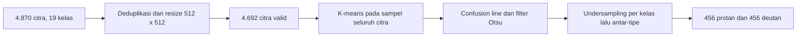
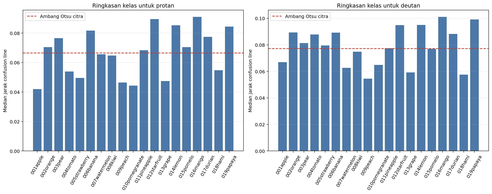

# Analisis Hasil NB01: Praproses Dataset

## Alur Penelitian

Analisis warna menggunakan seluruh citra termasuk latar. Hasil akhir memuat 912 keanggotaan dari 782 sumber unik; 130 sumber terdapat pada kedua tipe. Laporan mengacu pada artefak `output/` dalam folder `tanpa_segmentasi`. Konfigurasi lokasi output di notebook masih menunjuk struktur folder sebelumnya, sehingga lokasi tersebut perlu diperhatikan saat menjalankan ulang.

## Landasan Teori, Persamaan Literatur, dan Formulasi Operasional

### 1. Deduplikasi Perceptual Hash dan Jarak Hamming

#### A. Persamaan dan Makna

\[
d_H(h^{(1)},h^{(2)})=\sum_k\mathbf{1}[h_k^{(1)}\ne h_k^{(2)}].
\]

Jarak menghitung jumlah bit hash yang berbeda. Implementasi memanggil `imagehash.phash` dan membandingkan hash dalam kelas yang sama. Ambang `PHASH_THRESHOLD = 4` adalah parameter operasional; kedekatan hash tidak menjamin dua citra identik secara semantik.

#### B. Implementasi Operasional pada NB01

Berkas diurutkan, lalu dibandingkan dengan citra yang sudah dipertahankan. Sebanyak 178 dari 4.870 citra terdeteksi sebagai duplikat, menyisakan 4.692 citra. Deduplikasi belum dilakukan lintas kelas.

### 2. Normalisasi Geometris

#### A. Parameter dan Proses

Sisi crop adalah `min(tinggi, lebar)`. Area persegi dipotong dari tengah dan diubah menjadi 512 x 512 piksel dengan `cv2.INTER_AREA`. Rasio aspek area yang dipotong dipertahankan, tetapi objek di tepi dapat terpotong.

#### B. Implementasi Operasional pada NB01

Normalisasi menyamakan resolusi, tanpa mengoreksi pencahayaan atau mengkalibrasi warna kamera. Analisis warna mengambil sampel langsung dari citra 512 x 512.

### 3. K-means pada Seluruh Citra

#### A. Tujuan Ekstraksi Warna

Sebanyak maksimal 1.000 piksel diambil acak tanpa pengembalian dari citra penuh 512 x 512. Sampel RGB dinormalisasi ke 0-1 dan dikelompokkan dengan K-means menjadi empat pusat warna. Tidak ada mask objek atau resize untuk GrabCut.

#### B. Implementasi Operasional

Kode memakai `cv2.kmeans`, inisialisasi K-means++, tiga percobaan, maksimum 50 iterasi, epsilon 0,2, dan seed 42. Parameter ini adalah konfigurasi implementasi. Pusat warna dikonversi ke CIE xy sebelum pengukuran confusion line.

#### C. Batas Interpretasi

Latar ikut menentukan pusat warna. Hasil menggambarkan pasangan warna dalam seluruh gambar dan tidak dapat dinyatakan khusus sebagai warna permukaan buah. Keberhasilan analisis berarti perhitungan selesai, bukan validasi terhadap persepsi manusia.

### 4. Pengukuran Jarak terhadap Confusion Line

#### A. Persamaan Acuan Notebook

NB01 merujuk persamaan jarak titik ke garis pada Tsekouras et al. (2021), Persamaan 12:

\[
d(v,L)=\frac{|(x_{cp}-x_0)(y_0-v_y)-(x_0-v_x)(y_{cp}-y_0)|}{\sqrt{(x_{cp}-x_0)^2+(y_{cp}-y_0)^2}}.
\]

#### B. Keterangan Variabel dan Parameter NB01

`(x_cp, y_cp)` adalah copunctal point: protan (0,763; 0,236) dan deutan (1,4; -0,4). `(x_0, y_0)` merupakan pusat warna pembentuk garis, sedangkan `(v_x, v_y)` merupakan pusat warna pembanding. Empat pusat menghasilkan enam pasangan yang diperiksa dua arah, atau 12 jarak per tipe untuk satu citra.

#### C. Referensi dan Ruang Lingkup Adaptasi

[Tsekouras et al. (2021), A Novel Approach to Image Recoloring for Color Vision Deficiency](https://doi.org/10.3390/s21082740) membahas ekstraksi warna kunci dan pemetaan confusion line untuk recoloring. Pengambilan sampel seluruh citra, K-means empat cluster, median dua arah, dan filter kelas merupakan adaptasi pipeline penelitian ini. Keseluruhan pipeline bukan replikasi identik metode artikel tersebut.

#### D. Interpretasi

Jarak kecil menunjukkan kedekatan geometris pasangan warna terhadap garis kebingungan yang sama. Ini bukan bukti bahwa buah sulit dikenali semua penderita CVD. Warna yang memang sudah mirip juga dapat menghasilkan jarak kecil. Luminansi dan variasi warna dalam cluster belum dinilai oleh jarak xy saja.

### 5. Otsu pada Distribusi Jarak Per Citra

#### A. Kriteria Ambang

\[
t^*=\arg\max_t\sigma_B^2(t),\qquad
\sigma_B^2(t)=\omega_0(t)\omega_1(t)[\mu_0(t)-\mu_1(t)]^2.
\]

Histogram berisi median jarak pasangan warna per citra. Rentang minimum-maksimum dipetakan ke 0-255 sebelum `cv2.THRESH_OTSU`, lalu ambang dikembalikan ke skala jarak. Pemetaan menghasilkan kuantisasi 256 tingkat. Otsu tidak lagi diterapkan pada saturasi gabungan kelas.

#### B. Implementasi Operasional pada NB01

Ambang protan 0,066446554640 dan deutan 0,077133044290 dihitung terpisah dari 4.692 citra valid. Ambang membagi distribusi data dan tidak dikalibrasi sebagai ambang persepsi manusia.

### 6. Filter Kelas dan Filter Citra

#### A. Aturan Pemilihan

Kelas lolos jika mean dan median dari median jarak per citranya sama-sama tidak melebihi ambang tipe. Di dalam kelas lolos, hanya citra dengan median jarak tidak melebihi ambang yang menjadi kandidat undersampling. Aturan gabungan ini adalah keputusan operasional, bukan persamaan seleksi kelas buah dari artikel recoloring.

#### B. Hasil dan Sensitivitas Batas

Protan memilih 9 kelas dan deutan 8 kelas. Gabungan mencakup 10 kelas; tujuh kelas muncul pada kedua tipe. Keputusan bergantung pada distribusi warna seluruh citra, sampel acak, dan kuantisasi Otsu. Kelas lolos belum berarti semua citranya lolos ambang.

### 7. Penyeimbangan Jumlah per Kelas dalam Setiap Tipe

#### A. Formulasi Operasional

Kuota tipe adalah jumlah kandidat terkecil di antara kelas yang lolos untuk tipe tersebut. Pengambilan acak memakai `random_state = 42`. Kuota minimum mendeskripsikan desain sampling notebook dan tidak diklaim sebagai persamaan artikel confusion line.

#### B. Hasil Otomatis pada Dataset

Kuota awal protan adalah 68 per kelas, menghasilkan 9 x 68 = 612 citra. Kuota deutan 57 per kelas menghasilkan 8 x 57 = 456 citra. Sampling lanjutan mengurangi protan menjadi 456. Jumlah protan per kelas akhirnya 46-54, sedangkan deutan tetap 57 per kelas.

## Tahapan Eksekusi dan Hasil Pemrosesan

### 1. Inventarisasi Data Sumber

Dataset train memuat 4.870 citra pada 19 kelas setelah kelas `000neg` dikecualikan. Pipeline aktif tidak menggunakan seleksi rentang hue merah/hijau; keputusan kelas dibuat dari jarak warna ke confusion line dan ambang Otsu.

### 2. Deduplikasi dan Resize

Sebanyak 178 citra terdeteksi duplikat intra-kelas, menyisakan 4.692 citra. Citra keluaran utama berukuran 512 x 512. Tidak ada pemisahan foreground-background pada versi ini.

### 3. Analisis Seluruh Citra dan Confusion Line

Seluruh 4.692 citra berhasil dianalisis; tidak ada kegagalan analisis. Empat pusat warna menghasilkan 12 jarak dua arah per tipe. Median jarak tiap citra kemudian diringkas per kelas.

### 4. Seleksi Kelas dan Citra

Filter kelas memakai mean dan median jarak per citra, keduanya harus tidak melebihi ambang Otsu. Citra dalam kelas lolos kemudian disaring dengan ambang yang sama.

### 5. Undersampling dan Ekspor

Hasil akhir 456 citra per tipe, total 912 keanggotaan. Irisan 130 sumber menghasilkan 782 citra unik. Keluaran tetap gambar penuh 512 x 512.

## Ringkasan Hasil Praproses

| Parameter / Metrik | Nilai |
| --- | --- |
| Citra mentah / kelas | 4.870 / 19 |
| Duplikat / setelah resize | 178 / 4.692 |
| Analisis berhasil / gagal | 4.692 / 0 |
| Ambang protan / deutan | 0,06644655 / 0,07713304 |
| Kelas protan / deutan | 9 / 8 |
| Hasil kuota kelas protan / deutan | 612 / 456 |
| Final protan / deutan | 456 / 456 |
| Keanggotaan / sumber unik / irisan | 912 / 782 / 130 |
| Resolusi | 512 x 512 |

## Rincian Distribusi Kelas Sebelum dan Sesudah Undersampling

| Kelas | Analisis valid | Kandidat protan | Final protan | Kandidat deutan | Final deutan |
| --- | --- | --- | --- | --- | --- |
| 001apple | 398 | 376 | 46 | 288 | 57 |
| 002orange | 424 | 0 | 0 | 0 | 0 |
| 003pear | 263 | 0 | 0 | 0 | 0 |
| 004tomato | 404 | 330 | 52 | 0 | 0 |
| 005strawberry | 441 | 383 | 51 | 0 | 0 |
| 006banana | 372 | 0 | 0 | 0 | 0 |
| 007watermelon | 233 | 117 | 47 | 167 | 57 |
| 008kiwi | 301 | 161 | 54 | 173 | 57 |
| 009peach | 400 | 340 | 51 | 329 | 57 |
| 010pomegranate | 261 | 233 | 52 | 184 | 57 |
| 011pineapple | 216 | 0 | 0 | 0 | 0 |
| 012starfruit | 155 | 0 | 0 | 0 | 0 |
| 013grape | 154 | 118 | 50 | 128 | 57 |
| 014lemon | 141 | 0 | 0 | 0 | 0 |
| 015pomelo | 112 | 0 | 0 | 57 | 57 |
| 016mango | 144 | 0 | 0 | 0 | 0 |
| 017durian | 114 | 0 | 0 | 0 | 0 |
| 018hami | 101 | 68 | 53 | 79 | 57 |
| 019papaya | 58 | 0 | 0 | 0 | 0 |

Nol pada kandidat berarti tidak ada citra kelas tersebut yang masuk seleksi tipe. Penyeimbangan akhir menyamakan total antar-tipe; jumlah akhir per kelas protan tidak lagi seragam.

## Analisis Hubungan Antar-Variabel: Keterkaitan ke NB02 dan NB03

### 1. Apa yang Dipersiapkan di NB01?

Seleksi berdasarkan geometri warna seluruh citra. Jarak confusion line dan Delta E00 asli-simulasi merupakan ukuran yang berbeda.

### 2. Mengapa Penyeimbangan Dilakukan?

Total menjadi 456 per tipe. Komposisi kelas dan identitas citra tetap berbeda.

### 3. Hubungan dengan Tahap Downstream (NB02 dan NB03)

NB02 menghasilkan 912 x 4 = 3.648 simulasi. NB03 membandingkan kelompok lengkap serta 130 sumber pada irisan, yaitu 520 pasangan kondisi.

### 4. Bagaimana Kontrol Kualitas Ditegakkan?

Status, hash, kelas sumber, dan jarak disimpan. Latar ikut berkontribusi pada seleksi serta evaluasi; hasil tidak membuktikan kemampuan pengenalan buah peserta CVD.

## Artefak Aktif

| Berkas Keluaran | Makna |
| --- | --- |
| [dataset_preparation_summary.json](output/dataset_preparation_summary.json) | Jumlah tahap, parameter, ambang, kelas terpilih, dan hasil penyeimbangan akhir. |
| [deduplication_report.csv](output/deduplication_report.csv) | Catatan duplikat intra-kelas. |
| [dataset_preparation_errors.csv](output/dataset_preparation_errors.csv) | Log kesalahan praproses; kegagalan analisis warna disimpan terpisah. |
| [confusion_line_image_analysis.csv](output/confusion_line_image_analysis.csv) | Status analisis dan jarak per citra. |
| [confusion_line_class_summary.csv](output/confusion_line_class_summary.csv) | Statistik jarak per kelas dan keputusan filter. |
| [confusion_line_filter_summary.csv](output/confusion_line_filter_summary.csv) | Ambang Otsu, jumlah kelas, dan jumlah citra akhir per tipe. |
| [confusion_line_selected_by_cvd.csv](output/confusion_line_selected_by_cvd.csv) | Manifest seleksi yang menjadi input utama NB02. |
| [dataset_preparation_report.csv](output/dataset_preparation_report.csv) | Status keanggotaan manifest gabungan. |
| [confusion_line_filtered/](output/confusion_line_filtered/) | Citra terpilih dalam subfolder protan dan deutan. |
| [confusion_line_class_summary.png](output/confusion_line_class_summary.png) | Median jarak kelas dan ambang Otsu. |

---

## Penjelasan Visual Aktif

### Grafik Ringkasan Jarak Kelas dan Ambang Otsu

Batang merangkum median jarak per kelas; garis ambang berasal dari Otsu pada distribusi per citra. Keputusan kelas memakai mean dan median sekaligus, sehingga posisi batang saja belum cukup menjelaskan kelolosan. Warna latar termasuk dalam pembentukan pusat warna.

### Distribusi Jarak Per Citra di Notebook

Sebaran jarak memperlihatkan heterogenitas dalam kelas. Median kelas rendah tidak menjamin semua citra lolos; kandidat masih disaring satu per satu sebelum undersampling.

