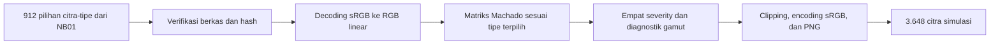
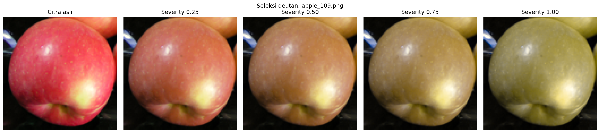
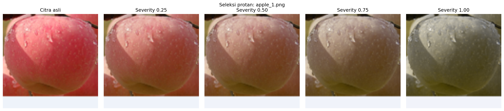

# Analisis Hasil NB02: Simulasi Buta Warna Parsial

## Alur Penelitian

NB02 membaca manifest NB01 yang memuat 456 pilihan protan dan 456 pilihan deutan dari 782 citra unik. Setiap keanggotaan citra-tipe menghasilkan empat severity: 0,25; 0,50; 0,75; dan 1,00, sehingga dihasilkan 3.648 citra simulasi. Sebanyak 130 identitas citra dipakai pada kedua tipe.

Manifest menentukan pekerjaan simulasi. Struktur keluaran adalah `simulated_images/<cvd>/severity_<nilai>/<buah>_<id>.png`. Kelas buah tetap disimpan sebagai metadata CSV untuk audit.

---

## Landasan Teori, Persamaan Fisiologis, dan Proses Komputasi

### 1. Model Fisiologis Machado et al. (2009)
Simulasi persepsi warna buta warna parsial dalam penelitian ini didasarkan pada formulasi pergeseran spektral kerucut (*cone spectral shift formulation*) yang diperkenalkan oleh:
> **Machado, G. M., Oliveira, M. M., & Fernandes, L. A. (2009).** *A physiologically-based model for simulation of color vision deficiency.* IEEE Transactions on Visualization and Computer Graphics, 15(6), 1291-1298. [DOI: 10.1109/TVCG.2009.113](https://doi.org/10.1109/TVCG.2009.113).

Model ini merepresentasikan fenomena bahwa pada individu anomalus trikromasi, puncak sensitivitas spektral fotopigmen kerucut yang cacat bergeser mendekati fotopigmen normal lainnya (kerucut L bergeser ke arah spektrum M pada protanomali, atau kerucut M bergeser ke arah spektrum L pada deuteranomali).

### 2. Linearisasi Ruang Warna sRGB
Citra digital masukan yang dibaca melalui antarmuka OpenCV berada pada representasi non-linear sRGB (rentang $[0, 255]$ dengan kompresi gamma). Karena pencampuran foton dan respons stimulasi kerucut retina bersifat aditif dalam domain radiometrik linear, transformasi kolorimetris tidak boleh diterapkan langsung pada nilai non-linear sRGB. Sesuai standar IEC 61966-2-1:1999, nilai sRGB dinormalisasi ke rentang $[0, 1]$ lalu ditransformasikan ke RGB linear ($\mathbf{c}_{lin} = [R_{lin}, G_{lin}, B_{lin}]^T$) melalui fungsi decoding sRGB:

\[
C_{lin} = 
\begin{cases} 
\frac{C_{sRGB}}{12{,}92}, & \text{jika } C_{sRGB} \le 0{,}04045 \\
\left(\frac{C_{sRGB} + 0{,}055}{1{,}055}\right)^{2{,}4}, & \text{jika } C_{sRGB} > 0{,}04045
\end{cases}
\]

dengan $C_{sRGB} \in \{R, G, B\} / 255{,}0$.

### 3. Transformasi Matriks Multivariat dan Interpolasi Severity
Setelah berada pada domain RGB linear, stimulasi spektral ditransformasikan menggunakan matriks transformasi Machado $\mathbf{\Gamma}_{CVD}(s)$:

\[
\mathbf{c}'_{lin} = \mathbf{\Gamma}_{CVD}(s) \cdot \mathbf{c}_{lin}
\]

Matriks $\mathbf{\Gamma}_{CVD}(s)$ adalah matriks transfer $3 \times 3$ yang bergantung pada tipe kelainan ($CVD \in \{\text{protan}, \text{deutan}\}$) dan parameter keparahan ($s \in [0, 1]$). Pada implementasi algoritma, untuk nilai keparahan di antara titik tabel acuan diskret ($s \in \{0{,}0; 0{,}1; \dots; 1{,}0\}$), matriks diinterpolasi secara linear berbobot:

\[
\mathbf{\Gamma}(s) = (1 - \alpha)\mathbf{\Gamma}(s_k) + \alpha\mathbf{\Gamma}(s_{k+1}), \quad \alpha = \frac{s - s_k}{s_{k+1} - s_k}
\]

Ketika $s=0$, matriks identitas merepresentasikan kondisi tanpa transformasi CVD. Severity 0,25 dan 0,75 memakai interpolasi antara titik tabel terdekat, sedangkan 0,50 dan 1,00 tersedia langsung dalam tabel implementasi. Parameter ini mengatur model dan tidak menetapkan diagnosis klinis subjek tertentu.

### 4. Pembatasan Gamut (Gamut Clipping) dan Rekonversi sRGB
Transformasi linear dapat menggeser vektor warna keluar dari kubus gamut tampilan sRGB standar ($\mathbf{c}'_{lin} \notin [0, 1]^3$). Nilai komponen yang lebih kecil dari 0 (terpotong di batas bawah/gelap) atau lebih besar dari 1 (terpotong di batas atas/saturasi) dicatat untuk diagnostik gamut, kemudian dibatasi (*clamped*):

\[
C''_{lin} = \min(\max(C'_{lin}, 0{,}0), 1{,}0)
\]

Setelah pembatasan gamut, citra linear dikembalikan ke ruang non-linear sRGB (rentang $[0, 255]$) menggunakan fungsi encoding sRGB:

\[
C_{sRGB} = 
\begin{cases} 
12{,}92 \cdot C''_{lin}, & \text{jika } C''_{lin} \le 0{,}0031308 \\
1{,}055 \cdot (C''_{lin})^{1/2{,}4} - 0{,}055, & \text{jika } C''_{lin} > 0{,}0031308
\end{cases}
\]

dan dikodekan ke format bilangan bulat 8-bit dengan kuantisasi 8-bit, lalu disimpan sebagai PNG nirrugi.

Transformasi bekerja pada warna setiap piksel tanpa memindahkan posisi piksel. Kontras warna antartepi dapat berubah walaupun koordinat dan ukuran citra tetap.

---

## Analisis Hasil Simulasi

### 1. Ringkasan Global Tingkat Kondisi Simulasi

| Tipe | Severity | Citra | Mean selisih RGB | Piksel berubah | Clipping |
| --- | --- | --- | --- | --- | --- |
| deutan | 0,25 | 456 | 0,021399 | 91,62% | 6,02% |
| deutan | 0,50 | 456 | 0,034435 | 94,12% | 6,30% |
| deutan | 0,75 | 456 | 0,043150 | 94,94% | 3,80% |
| deutan | 1,00 | 456 | 0,049649 | 95,31% | 6,55% |
| protan | 0,25 | 456 | 0,027647 | 93,52% | 11,48% |
| protan | 0,50 | 456 | 0,045856 | 95,23% | 12,79% |
| protan | 0,75 | 456 | 0,059727 | 95,50% | 10,70% |
| protan | 1,00 | 456 | 0,071928 | 95,57% | 13,07% |

Mean selisih RGB meningkat pada kedua tipe. Pada severity 1,00 nilainya 0,071928 untuk protan dan 0,049649 untuk deutan. Clipping tidak monoton terhadap severity.

### 2. Ringkasan Tingkat Kelompok Seleksi dan Kelas

Terdapat satu kelompok seleksi per tipe. Protan memuat 9 kelas dan deutan 8 kelas. Berikut kelas dengan mean selisih RGB terendah dan tertinggi pada severity 1,00.

| Tipe | Kelas | Citra | Mean selisih RGB |
| --- | --- | --- | --- |
| protan | 008kiwi | 54 | 0,024446 |
| protan | 004tomato | 52 | 0,128319 |
| deutan | 008kiwi | 57 | 0,021416 |
| deutan | 010pomegranate | 57 | 0,082856 |

### 3. Interpretasi Perubahan per Severity

Kenaikan severity memperbesar perubahan RGB rata-rata secara umum. Namun, angka ini merangkum perbedaan numerik kanal dan bukan penilaian langsung bahwa gambar lebih sulit dikenali. Clipping terjadi ketika hasil transformasi linear berada di luar gamut sRGB sebelum dikonversi kembali.

---

## Analisis Hubungan Antar-Variabel: Apa, Mengapa, Akibat, dan Bagaimana

### 1. Hubungan antara Severity dan Rata-rata Perubahan RGB

Pada semua kondisi, mean selisih RGB dan proporsi piksel berubah meningkat dari severity 0,25 ke 1,00. Kenaikan ini sesuai penggunaan matriks Machado pada tingkat severity yang lebih kuat. Perubahan tersebut tetap bergantung pada warna citra masukan.

### 2. Komposisi Kelompok Protan dan Deutan

Kedua kelompok sekarang sama-sama berisi 456 pilihan, tetapi terdiri dari kelas berbeda dan 130 sumber yang tumpang tindih. Karena itu, perbandingan rata-rata antarkelompok bersifat deskriptif. Analisis berpasangan pada sumber yang sama tersedia terpisah di NB03.

### 3. Dinamika Clipping Gamut Tampilan

Clipping memetakan komponen RGB linear di luar rentang tampilan ke batas gamut sebelum encoding sRGB. Proporsinya bervariasi antar-severity dan tipe. Nilai clipping menjelaskan keterbatasan representasi layar, bukan besarnya perbedaan warna secara perseptual.

---

## Visualisasi Severity

### Penjelasan Setiap Visual Aktif

Setiap panel memakai satu citra sumber yang sama pada empat severity. Perubahan warna dapat dibandingkan dalam panel tersebut; panel antar-tipe dapat memakai sumber berbeda. Seluruh latar ikut disimulasikan. Contoh visual tidak mewakili rata-rata kelompok dan tidak mengukur keberhasilan pengenalan buah.

## Artefak Aktif

| Berkas Keluaran | Makna |
| --- | --- |
| [simulation_summary.json](output/simulation_summary.json) | Jumlah input, keluaran, dan status proses. |
| [simulation_report.csv](output/simulation_report.csv) | Catatan hasil tiap citra, tipe, dan severity. |
| [simulation_group_summary.csv](output/simulation_group_summary.csv) | Ringkasan global tipe-severity. |
| [simulation_class_summary.csv](output/simulation_class_summary.csv) | Ringkasan kelas buah pada tiap kondisi. |
| [simulation_selection_summary.csv](output/simulation_selection_summary.csv) | Ringkasan kelompok seleksi. |
| [simulation_verification.csv](output/simulation_verification.csv) | Verifikasi output simulasi. |
| [simulation_errors.csv](output/simulation_errors.csv) | Catatan kegagalan proses; pada run aktif tidak ada kegagalan. |
| [simulated_images/](output/simulated_images/) | Citra simulasi per tipe dan severity. |
| [simulation_severity_deutan.png](output/simulation_severity_deutan.png) | Contoh visual deutan pada empat severity. |
| [simulation_severity_protan.png](output/simulation_severity_protan.png) | Contoh visual protan pada empat severity. |

Run aktif menghasilkan 3.648 dari 3.648 simulasi yang diharapkan tanpa error. Manifest dan hash input cocok dengan output NB01.
