# Analisis Hasil NB03: Evaluasi dan Visualisasi Perbedaan Warna CIEDE2000

## Alur Penelitian

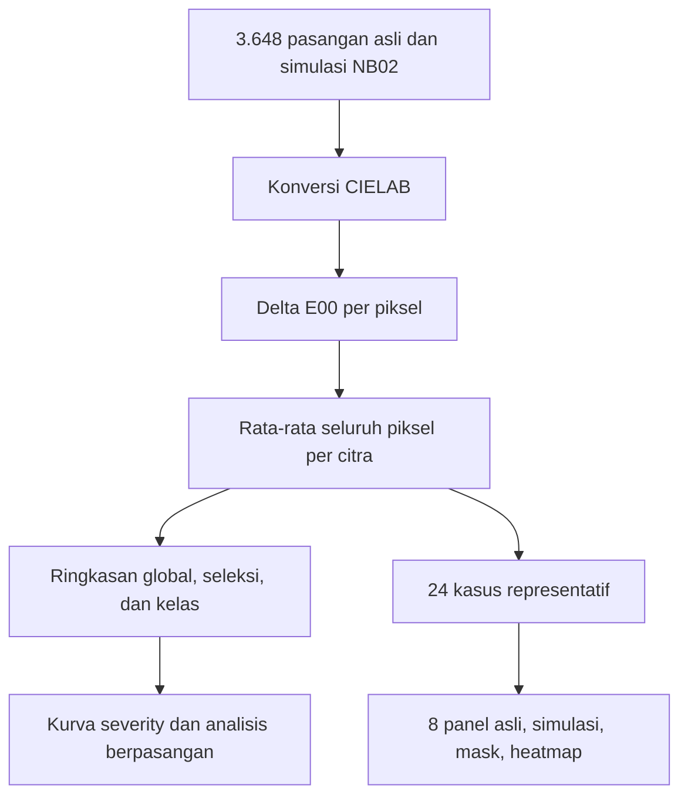

NB03 mengevaluasi 1.824 pasangan protan dan 1.824 pasangan deutan, empat severity untuk masing-masing 456 citra per tipe. Nilai $\Delta E_{00}$ dihitung pada seluruh citra, termasuk latar. Totalnya 3.648 evaluasi.

Output aktif mencakup ringkasan individu, kelas, kelompok seleksi, global, 24 kasus representatif, grafik severity, delapan panel, dan perbandingan berpasangan pada 130 sumber yang sama. Ringkasan utama antartipe menggunakan kelompok lengkap yang berbeda komposisi; hasil berpasangan menjawab perbandingan pada subset irisan.

---

## Landasan Teori, Persamaan Matematis, dan Formulasi CIEDE2000

### 1. Transformasi Kolorimetris sRGB ke CIELAB
Setiap pasangan citra digital (asli $I$ dan simulasi $S$) dikonversi dari representasi sRGB non-linear ke ruang warna CIELAB yang mendekati keseragaman perseptual ($L^*, a^*, b^*$) melalui ruang antara CIEXYZ dengan standar iluminan D65 ($X_n = 95{,}047, Y_n = 100{,}000, Z_n = 108{,}883$):

\[
L^* = 116 f(Y/Y_n) - 16, \quad a^* = 500 [f(X/X_n) - f(Y/Y_n)], \quad b^* = 200 [f(Y/Y_n) - f(Z/Z_n)]
\]

dengan fungsi transfer non-linear:

\[
f(t) = 
\begin{cases} 
t^{1/3}, & \text{jika } t > \left(\frac{6}{29}\right)^3 \\
\frac{1}{3}\left(\frac{29}{6}\right)^2 t + \frac{4}{29}, & \text{jika } t \le \left(\frac{6}{29}\right)^3
\end{cases}
\]

### 2. Formulasi Standar Metrik CIEDE2000
Metrik CIEDE2000 diimplementasikan berdasarkan standar resmi CIE dan formulasi komputasional terverifikasi dari:
> **Sharma, G., Wu, W., & Dalal, E. N. (2005).** *The CIEDE2000 color-difference formula: Implementation notes, supplementary test data, and mathematical observations.* Color Research & Application, 30(1), 21-30. [DOI: 10.1002/col.20070](https://doi.org/10.1002/col.20070).

Dua sampel warna dalam CIELAB, $(L^*_1, a^*_1, b^*_1)$ dan $(L^*_2, a^*_2, b^*_2)$, dievaluasi melalui tahapan:

#### a. Modifikasi Sumbu $a^*$ untuk Koreksi Kroma Rendah
Kromatisitas $C^*_{ab} = \sqrt{a^{*2} + b^{*2}}$ dirata-ratakan ($\overline{C}^*_{ab} = (C^*_{ab,1} + C^*_{ab,2})/2$), lalu faktor pembobot $G$ dihitung untuk meregangkan sumbu $a^*$ pada wilayah mendekati netral:

\[
G = 0{,}5 \left( 1 - \sqrt{\frac{\overline{C}^{*7}_{ab}}{\overline{C}^{*7}_{ab} + 25^7}} \right)
\]
\[
a'_i = (1 + G)a^*_i, \quad C'_i = \sqrt{a^{'2}_i + b^{*2}_i}, \quad h'_i = \text{atan2}(b^*_i, a'_i) \pmod{360^\circ}
\]

#### b. Selisih Metrik Komponen Luminansi, Kroma, dan Rona
Selisih dihitung sebagai:

\[
\Delta L' = L^*_2 - L^*_1, \quad \Delta C' = C'_2 - C'_1, \quad \Delta H' = 2\sqrt{C'_1 C'_2}\sin\left(\frac{\Delta h'}{2}\right)
\]

dengan $\Delta h' = h'_2 - h'_1$ yang dikoreksi ke rentang $[-180^\circ, 180^\circ]$.

#### c. Fungsi Pembobotan Posisi ($S_L, S_C, S_H$) dan Faktor Interaksi Rotasi ($R_T$)
Bobot penyesuaian non-seragam elips diskriminasi warna dihitung melalui:

\[
S_L = 1 + \frac{0{,}015(\overline{L}' - 50)^2}{\sqrt{20 + (\overline{L}' - 50)^2}}, \quad S_C = 1 + 0{,}045\overline{C}', \quad S_H = 1 + 0{,}015\overline{C}' T
\]

dengan faktor harmonik rona $T$:

\[
T = 1 - 0{,}17\cos(\overline{h}' - 30^\circ) + 0{,}24\cos(2\overline{h}') + 0{,}32\cos(3\overline{h}' + 6^\circ) - 0{,}20\cos(4\overline{h}' - 63^\circ)
\]

Interaksi rotasi elips pada wilayah biru dihitung melalui faktor $R_T$:

\[
R_T = -\sin(2\Delta\theta) R_C, \quad \Delta\theta = 30^\circ \exp\left( -\left[\frac{\overline{h}' - 275^\circ}{25^\circ}\right]^2 \right), \quad R_C = 2\sqrt{\frac{\overline{C}^{'7}}{\overline{C}^{'7} + 25^7}}
\]

#### d. Nilai Total Perbedaan Warna $\Delta E^*_{00}$
Dengan faktor parametrik standar $k_L = k_C = k_H = 1$ (kondisi pengamatan referensi CIE):

\[
\Delta E^*_{00} = \sqrt{\left(\frac{\Delta L'}{k_L S_L}\right)^2 + \left(\frac{\Delta C'}{k_C S_C}\right)^2 + \left(\frac{\Delta H'}{k_H S_H}\right)^2 + R_T\left(\frac{\Delta C'}{k_C S_C}\right)\left(\frac{\Delta H'}{k_H S_H}\right)}
\]

Untuk setiap pasangan citra $H \times W$ piksel ($512 \times 512 = 262.144$ piksel), metrik agregasi tingkat citra dihitung melalui rata-rata spasial (*spatial pooling mean*):

\[
\overline{\Delta E}_{00}(I, S) = \frac{1}{HW} \sum_{x=1}^{W}\sum_{y=1}^{H} \Delta E^*_{00}(I(x,y), S(x,y))
\]

Implementasi memakai `skimage.color.deltaE_ciede2000`, termasuk aturan selisih dan rerata sudut serta kasus kroma nol. Persamaan di atas adalah ringkasan; pada pasangan akromatik, aturan khusus tetap diperlukan. Referensi implementasi dan data uji tersedia pada [halaman penulis Sharma, Wu, dan Dalal](https://hajim.rochester.edu/ece/sites/gsharma/ciede2000/).

OpenCV mengonversi BGR uint8 ke Lab, kemudian kode memetakan L ke 0-100 dan mengurangi kanal a serta b dengan 128. Konversi 8-bit mengandung kuantisasi. Rata-rata mencakup seluruh piksel, termasuk latar. Versi NB01 ini juga menganalisis seluruh citra tanpa mask foreground. Rata-rata spasial merupakan ringkasan operasional citra, bukan bagian tambahan formula CIEDE2000.

---

## Hasil Evaluasi 4 Level Hierarkis (Tabel Pembantu Bab 5)

### 1. Level 4: Ringkasan Kondisi Global (Global / Kondisi Simulasi)

| Tipe | Severity | Citra | Mean Delta E00 | SD | Median | Minimum | Maksimum |
| --- | --- | --- | --- | --- | --- | --- | --- |
| deutan | 0,25 | 456 | 4,2221 | 2,0812 | 4,0546 | 0,3132 | 9,2281 |
| deutan | 0,50 | 456 | 7,5620 | 4,0301 | 7,0788 | 0,5727 | 17,6317 |
| deutan | 0,75 | 456 | 10,1270 | 5,6841 | 9,2450 | 0,7437 | 24,4944 |
| deutan | 1,00 | 456 | 12,1769 | 7,0160 | 11,0216 | 0,8719 | 30,5124 |
| protan | 0,25 | 456 | 4,1950 | 1,6219 | 4,4106 | 0,6090 | 7,7726 |
| protan | 0,50 | 456 | 7,8448 | 3,2538 | 8,1914 | 1,1598 | 15,4577 |
| protan | 0,75 | 456 | 11,2274 | 4,9946 | 11,5825 | 1,2982 | 23,4534 |
| protan | 1,00 | 456 | 14,8398 | 7,1772 | 14,9486 | 1,4492 | 33,1067 |

Seluruh 3.648 evaluasi memiliki mean 9,0244 dan simpangan baku 6,0331. Minimum 0,3132 dan maksimum 33,1067. Unit ringkasan adalah mean seluruh piksel per citra.

### 2. Level 3: Ringkasan Kelompok Seleksi Confusion Line

Terdapat satu kelompok seleksi untuk setiap tipe, `confusion_line_protan` dan `confusion_line_deutan`, masing-masing berisi 456 citra pada setiap severity. Karena hanya satu kelompok seleksi per tipe, ringkasannya sama dengan baris global untuk tipe-severity yang sama. Kelompok lengkap ini memiliki komposisi kelas yang berbeda, sehingga selisih protan-deutan pada tabel bukan efek tipe yang terisolasi.

### 3. Level 2: Ringkasan Tingkat Kelas Buah pada Kondisi Ekstrem (Severity 1,00)

| Tipe | Kelas | Citra | Mean Delta E00 |
| --- | --- | --- | --- |
| protan | 018hami | 53 | 5,7799 |
| protan | 004tomato | 52 | 23,9819 |
| deutan | 018hami | 57 | 5,5597 |
| deutan | 001apple | 57 | 19,8654 |

Tabel menampilkan kelas dengan mean terendah dan tertinggi per tipe. Komposisi latar serta jumlah sampel per kelas ikut menentukan hasil.

## Analisis Mendalam Hubungan Antar-Variabel: Apa, Mengapa, Akibat, dan Bagaimana

### 1. Hubungan antara Severity dan Nilai $\Delta E_{00}$ Global

Mean deutan meningkat dari 4,2221 ke 12,1769; protan dari 4,1950 ke 14,8398. Identitas citra tetap dalam satu tipe pada empat severity sehingga tren menggambarkan perubahan parameter model pada kumpulan sumber yang sama.

### 2. Variasi Sampel dan Kontribusi Latar

Seluruh citra digunakan pada seleksi NB01 dan evaluasi NB03. Latar dapat menguasai pusat warna maupun mean Delta E00 bila luas atau perubahannya besar. Hasil tidak khusus mengukur permukaan buah.

### 3. Komparasi Karakteristik Deutan vs Protan

Pada kelompok lengkap, deutan sedikit lebih tinggi pada severity 0,25; protan lebih tinggi pada 0,50-1,00. Pada irisan 130 sumber yang sama, nilai tiap tipe diringkas secara terpisah pada tabel berikut. Setiap baris memuat 130 citra untuk satu tipe dan satu severity.

| Tipe | Severity | Citra berpasangan | Mean Delta E00 | SD | Median | Minimum | Maksimum |
| --- | --- | ---: | ---: | ---: | ---: | ---: | ---: |
| deutan | 0,25 | 130 | 4,0402 | 2,0967 | 4,0080 | 0,4891 | 9,2281 |
| deutan | 0,50 | 130 | 7,2483 | 4,0507 | 6,8690 | 0,8589 | 17,6317 |
| deutan | 0,75 | 130 | 9,7436 | 5,7147 | 9,0334 | 1,2258 | 24,4944 |
| deutan | 1,00 | 130 | 11,7515 | 7,0686 | 10,8058 | 1,4868 | 29,8908 |
| protan | 0,25 | 130 | 3,4562 | 1,5951 | 3,4347 | 0,6090 | 6,5293 |
| protan | 0,50 | 130 | 6,3053 | 3,0834 | 6,3105 | 1,1598 | 12,5559 |
| protan | 0,75 | 130 | 8,7759 | 4,5545 | 8,6326 | 1,2982 | 18,9554 |
| protan | 1,00 | 130 | 11,2352 | 6,2888 | 10,8817 | 1,4492 | 26,8956 |

Pada keempat severity, mean deutan lebih tinggi daripada mean protan pada irisan ini. Rincian selisih berpasangan ditampilkan terpisah berikut.

| Severity | Pasangan | Mean protan | Mean deutan | Deutan - protan | Median selisih |
| --- | ---: | ---: | ---: | ---: | ---: |
| 0,25 | 130 | 3,4562 | 4,0402 | 0,5840 | 0,3173 |
| 0,50 | 130 | 6,3053 | 7,2483 | 0,9430 | 0,3572 |
| 0,75 | 130 | 8,7759 | 9,7436 | 0,9677 | 0,3170 |
| 1,00 | 130 | 11,2352 | 11,7515 | 0,5163 | 0,1260 |

Perbedaan arah pada kelompok lengkap dan irisan menunjukkan bahwa hasil perbandingan bergantung pada citra yang masuk ke setiap kelompok. Hasil bersifat deskriptif; tidak ada uji signifikansi atau pengujian peserta CVD dalam ringkasan ini.

## Kasus Representatif (Level 1: Per Individu)

| Tipe | Severity | Kasus | Sumber | Mean Delta E00 |
| --- | --- | --- | --- | --- |
| deutan | 0,25 | terendah | 018hami/31.png | 0,3132 |
| deutan | 0,25 | mendekati_median | 007watermelon/221.png | 4,0533 |
| deutan | 0,25 | tertinggi | 010pomegranate/68.png | 9,2281 |
| deutan | 0,50 | terendah | 018hami/31.png | 0,5727 |
| deutan | 0,50 | mendekati_median | 013grape/30.png | 7,0500 |
| deutan | 0,50 | tertinggi | 010pomegranate/68.png | 17,6317 |
| deutan | 0,75 | terendah | 018hami/31.png | 0,7437 |
| deutan | 0,75 | mendekati_median | 007watermelon/134.png | 9,1700 |
| deutan | 0,75 | tertinggi | 010pomegranate/68.png | 24,4944 |
| deutan | 1,00 | terendah | 018hami/31.png | 0,8719 |
| deutan | 1,00 | mendekati_median | 007watermelon/151.png | 11,0412 |
| deutan | 1,00 | tertinggi | 010pomegranate/173.png | 30,5124 |
| protan | 0,25 | terendah | 018hami/98.png | 0,6090 |
| protan | 0,25 | mendekati_median | 007watermelon/216.png | 4,4093 |
| protan | 0,25 | tertinggi | 004tomato/191.png | 7,7726 |
| protan | 0,50 | terendah | 018hami/98.png | 1,1598 |
| protan | 0,50 | mendekati_median | 005strawberry/172.png | 8,1864 |
| protan | 0,50 | tertinggi | 004tomato/191.png | 15,4577 |
| protan | 0,75 | terendah | 018hami/98.png | 1,2982 |
| protan | 0,75 | mendekati_median | 013grape/85.png | 11,5763 |
| protan | 0,75 | tertinggi | 004tomato/191.png | 23,4534 |
| protan | 1,00 | terendah | 018hami/98.png | 1,4492 |
| protan | 1,00 | mendekati_median | 009peach/229.png | 14,9232 |
| protan | 1,00 | tertinggi | 004tomato/191.png | 33,1067 |

Kasus dipilih ulang per kondisi. Contoh mendekati median tidak selalu tepat sama dengan median statistik karena jumlah citra genap.

## Visualisasi Severity

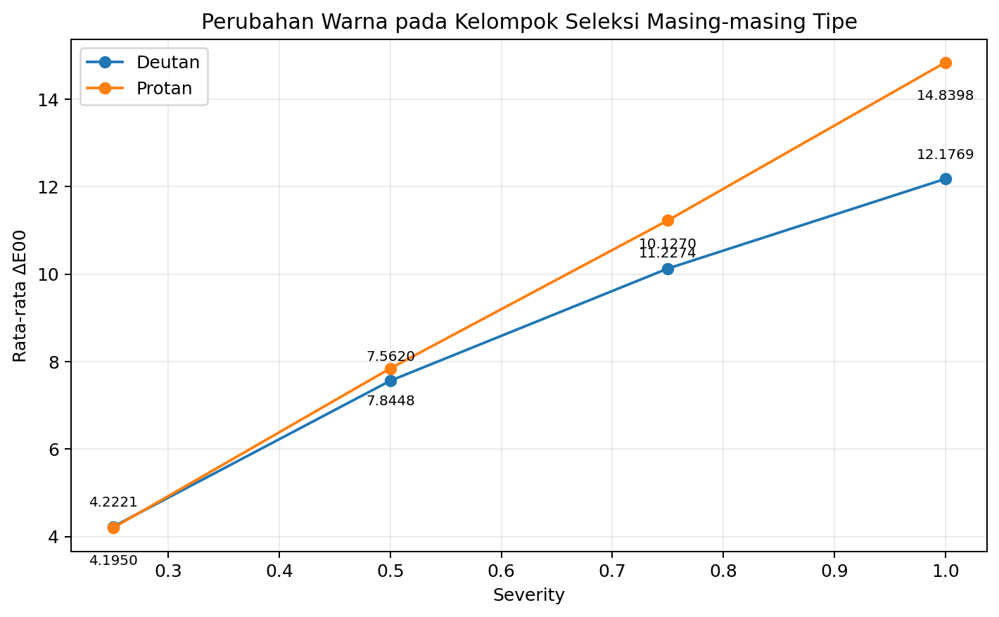

Kurva meningkat untuk kedua tipe; pada 0,25 deutan sedikit lebih tinggi, lalu protan lebih tinggi pada tiga severity berikutnya.

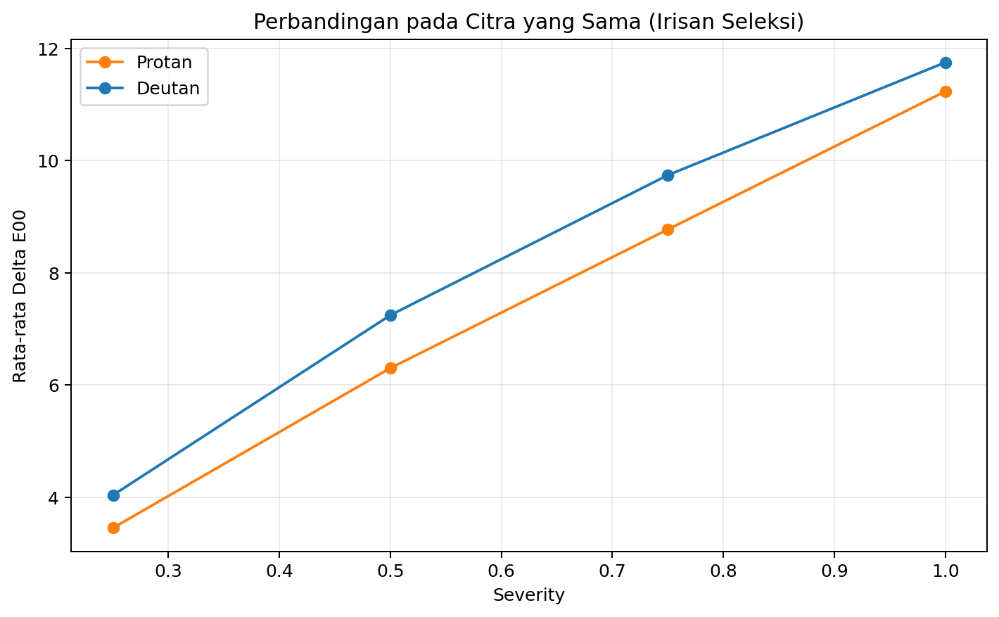

Pada 130 sumber yang sama, kurva deutan berada di atas protan pada seluruh severity. Irisan ini merupakan subset terpilih, sehingga tidak otomatis mewakili semua citra dataset.

## Penjelasan Setiap Visual Aktif (8 Panel Komparatif)

Setiap panel memuat asli, simulasi, mask perubahan numerik, dan heatmap Delta E00 seluruh citra. Mask bukan segmentasi buah. Besarnya area berubah tidak menentukan besarnya mean perbedaan warna.

### 1. Panel Visual Deutan

#### Severity 0,25

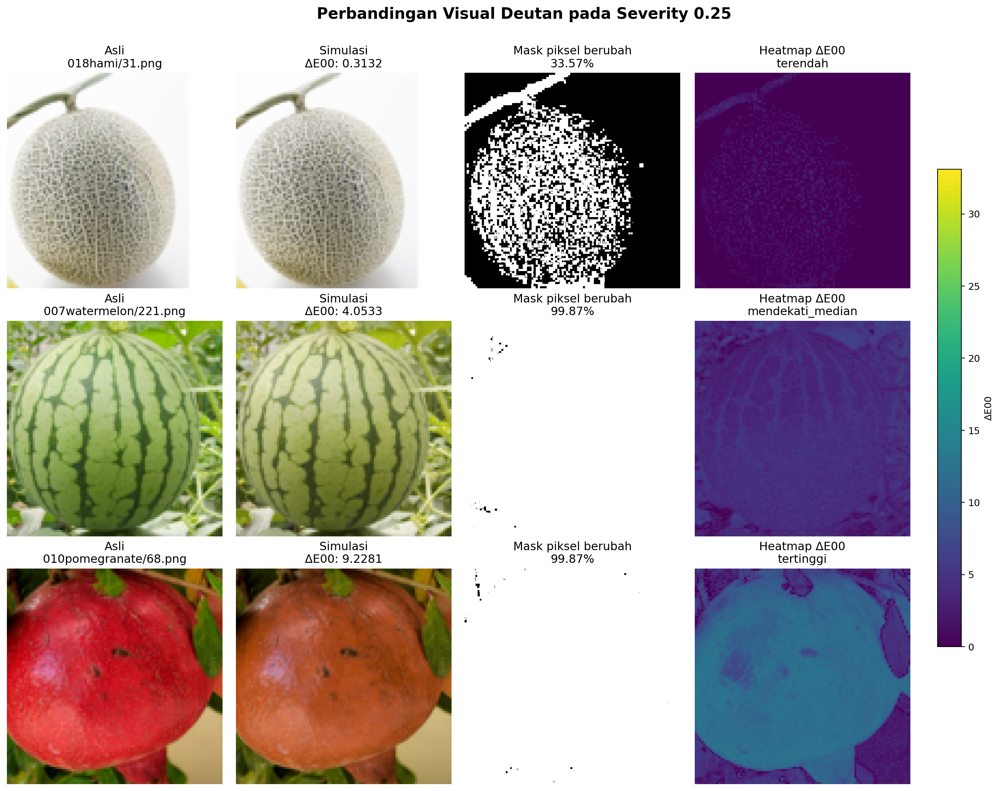

terendah: `018hami/31.png` dengan mean 0,3132; mendekati_median: `007watermelon/221.png` dengan mean 4,0533; tertinggi: `010pomegranate/68.png` dengan mean 9,2281.

Kasus terendah dan tertinggi menunjukkan rentang perubahan pada kondisi ini. Heatmap menunjukkan lokasi perubahan buah maupun latar; angka merupakan rata-rata seluruh gambar.

#### Severity 0,50

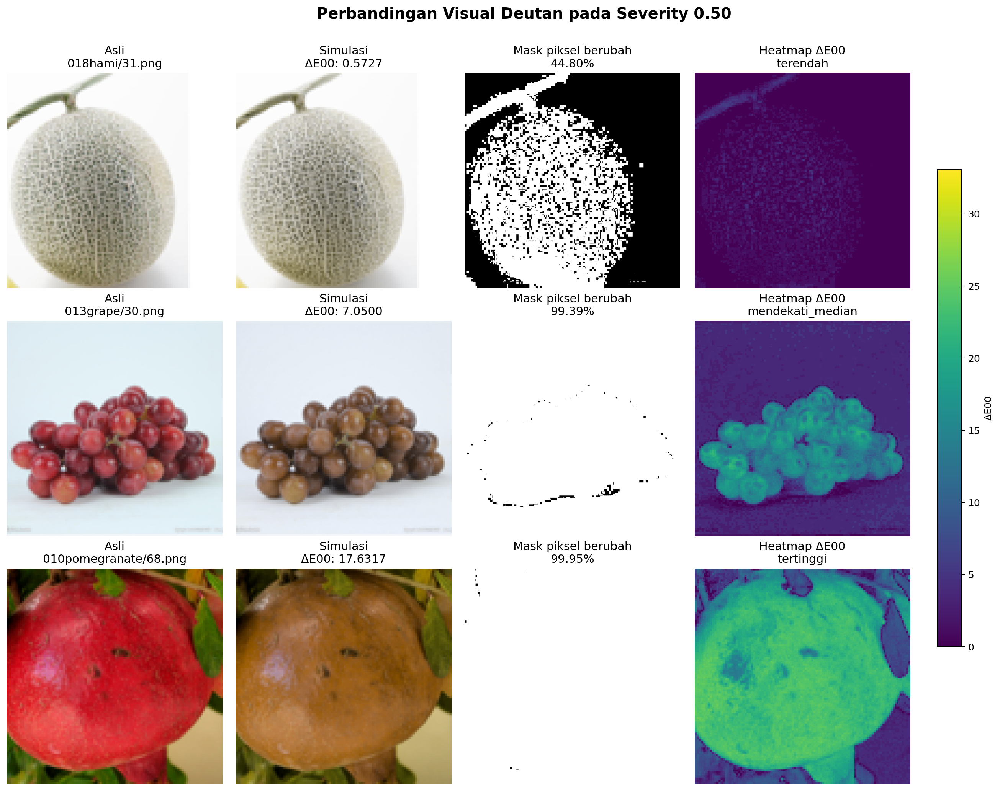

terendah: `018hami/31.png` dengan mean 0,5727; mendekati_median: `013grape/30.png` dengan mean 7,0500; tertinggi: `010pomegranate/68.png` dengan mean 17,6317.

Kasus terendah dan tertinggi menunjukkan rentang perubahan pada kondisi ini. Heatmap menunjukkan lokasi perubahan buah maupun latar; angka merupakan rata-rata seluruh gambar.

#### Severity 0,75

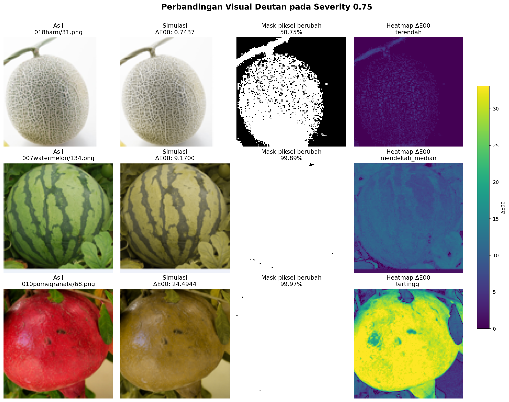

terendah: `018hami/31.png` dengan mean 0,7437; mendekati_median: `007watermelon/134.png` dengan mean 9,1700; tertinggi: `010pomegranate/68.png` dengan mean 24,4944.

Kasus terendah dan tertinggi menunjukkan rentang perubahan pada kondisi ini. Heatmap menunjukkan lokasi perubahan buah maupun latar; angka merupakan rata-rata seluruh gambar.

#### Severity 1,00

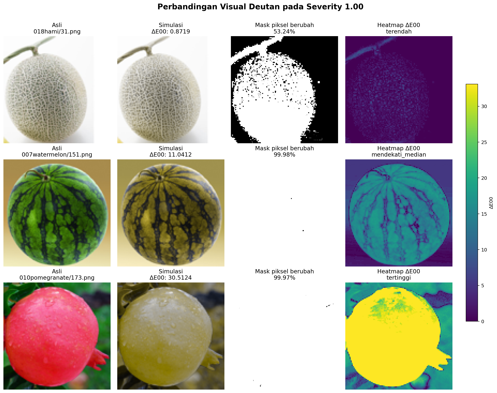

terendah: `018hami/31.png` dengan mean 0,8719; mendekati_median: `007watermelon/151.png` dengan mean 11,0412; tertinggi: `010pomegranate/173.png` dengan mean 30,5124.

Kasus terendah dan tertinggi menunjukkan rentang perubahan pada kondisi ini. Heatmap menunjukkan lokasi perubahan buah maupun latar; angka merupakan rata-rata seluruh gambar.

### 2. Panel Visual Protan

#### Severity 0,25

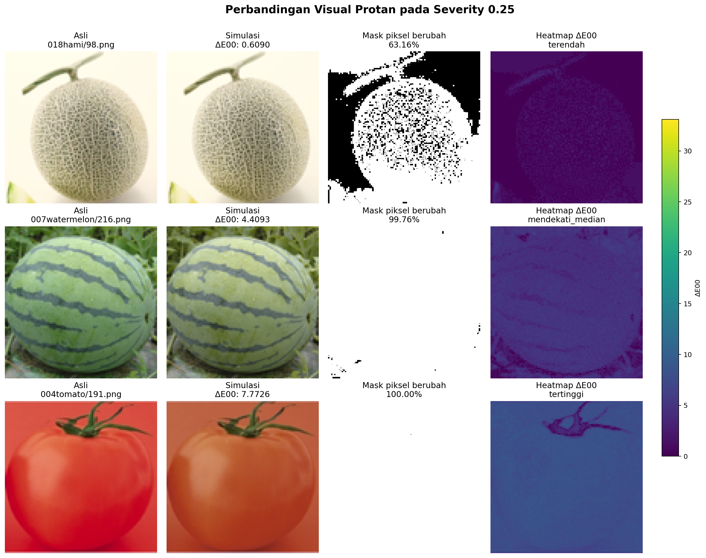

terendah: `018hami/98.png` dengan mean 0,6090; mendekati_median: `007watermelon/216.png` dengan mean 4,4093; tertinggi: `004tomato/191.png` dengan mean 7,7726.

Kasus terendah dan tertinggi menunjukkan rentang perubahan pada kondisi ini. Heatmap menunjukkan lokasi perubahan buah maupun latar; angka merupakan rata-rata seluruh gambar.

#### Severity 0,50

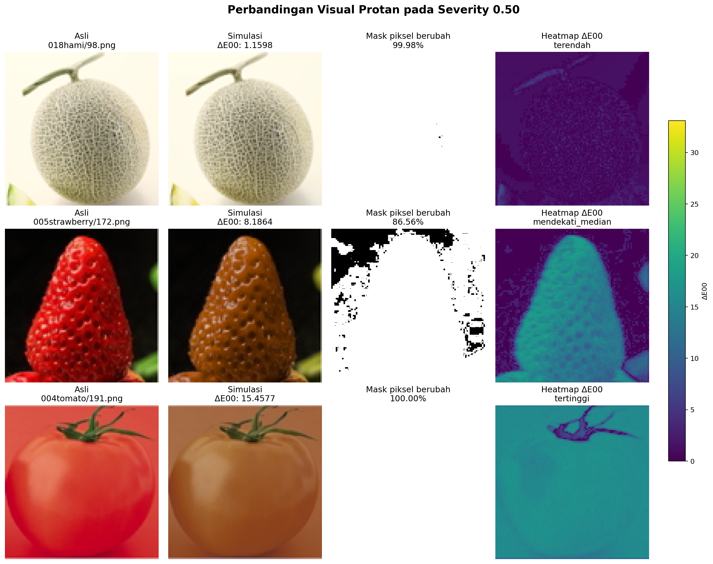

terendah: `018hami/98.png` dengan mean 1,1598; mendekati_median: `005strawberry/172.png` dengan mean 8,1864; tertinggi: `004tomato/191.png` dengan mean 15,4577.

Kasus terendah dan tertinggi menunjukkan rentang perubahan pada kondisi ini. Heatmap menunjukkan lokasi perubahan buah maupun latar; angka merupakan rata-rata seluruh gambar.

#### Severity 0,75

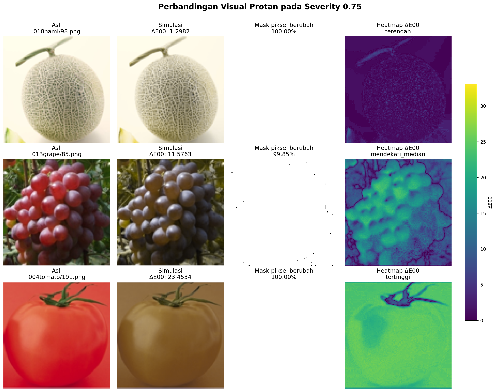

terendah: `018hami/98.png` dengan mean 1,2982; mendekati_median: `013grape/85.png` dengan mean 11,5763; tertinggi: `004tomato/191.png` dengan mean 23,4534.

Kasus terendah dan tertinggi menunjukkan rentang perubahan pada kondisi ini. Heatmap menunjukkan lokasi perubahan buah maupun latar; angka merupakan rata-rata seluruh gambar.

#### Severity 1,00

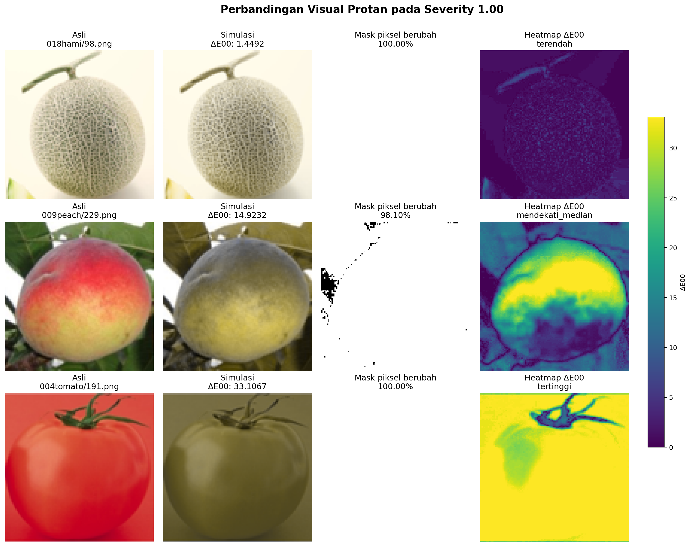

terendah: `018hami/98.png` dengan mean 1,4492; mendekati_median: `009peach/229.png` dengan mean 14,9232; tertinggi: `004tomato/191.png` dengan mean 33,1067.

Kasus terendah dan tertinggi menunjukkan rentang perubahan pada kondisi ini. Heatmap menunjukkan lokasi perubahan buah maupun latar; angka merupakan rata-rata seluruh gambar.

## Artefak Aktif

| Berkas Keluaran | Makna |
| --- | --- |
| [evaluation_individual.csv](output/evaluation_individual.csv) | Evaluasi per citra, tipe, dan severity. |
| [evaluation_class_summary.csv](output/evaluation_class_summary.csv) | Ringkasan per kelas. |
| [evaluation_selection_summary.csv](output/evaluation_selection_summary.csv) | Ringkasan per kelompok seleksi. |
| [evaluation_global_summary.csv](output/evaluation_global_summary.csv) | Ringkasan global tipe-severity. |
| [evaluation_paired_images.csv](output/evaluation_paired_images.csv) | Hasil berpasangan per citra yang muncul di kedua tipe. |
| [evaluation_paired_summary.csv](output/evaluation_paired_summary.csv) | Ringkasan delapan kondisi irisan, dipisah berdasarkan tipe dan severity. |
| [evaluation_paired_difference_summary.csv](output/evaluation_paired_difference_summary.csv) | Selisih rata-rata deutan-protan per severity pada irisan. |
| [evaluation_summary.json](output/evaluation_summary.json) | Metadata run, jumlah evaluasi, dan batas ruang metrik. |
| [representative_cases.csv](output/representative_cases.csv) | 24 kasus visual terpilih. |
| [mean_delta_e00_by_condition.png](output/mean_delta_e00_by_condition.png) | Kurva mean kelompok lengkap. |
| [paired_mean_delta_e00_by_condition.png](output/paired_mean_delta_e00_by_condition.png) | Perbandingan mean pada sumber yang sama. |
| [figures/](output/figures/) | Delapan panel asli, simulasi, mask, dan heatmap. |

---

## Kesimpulan dan Keterkaitan Lintas Notebook

NB01 memilih 456 citra per tipe dari warna seluruh gambar. NB02 menghasilkan 3.648 simulasi. NB03 menunjukkan mean perubahan meningkat bersama severity. Pada 130 sumber yang sama, mean deutan lebih tinggi pada seluruh severity; pada kelompok lengkap arahnya bergantung pada severity. Komposisi sampel dan latar perlu diperhitungkan. Hasil adalah pengukuran menurut model, belum validasi kemampuan pengenalan buah oleh peserta CVD.

