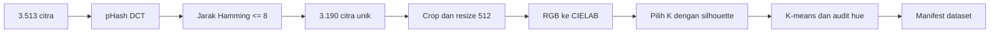
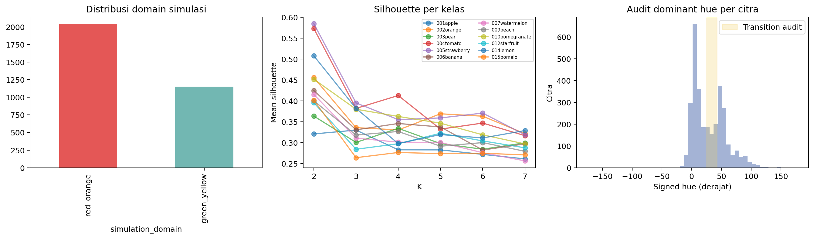

# Analisis Hasil NB01: Persiapan Dataset

## Alur penelitian

### Penjelasan setiap tahap

1. **Menetapkan 3.513 citra kandidat.** NB01 memakai citra dari 12 kelas sumber yang mewakili kelompok merah-oranye dan hijau-kuning hasil audit NB00. Jumlah ini menjadi populasi awal proses persiapan. File masih berada pada ukuran dan rasio aspek asal serta masih mungkin mengandung salinan atau variasi kompresi dari citra yang sama.
2. **Membentuk perceptual hash dengan DCT.** Setiap citra diringkas menjadi pHash berdasarkan komponen frekuensi rendah hasil Discrete Cosine Transform. Komponen tersebut lebih mewakili struktur visual umum daripada nilai piksel persis, sehingga citra yang sama masih dapat dikenali setelah resize atau kompresi ringan. Hash digunakan sebagai tanda pengenal untuk perbandingan dalam kelas yang sama.
3. **Membandingkan jarak Hamming.** Bit pada hash kandidat dibandingkan dengan hash citra yang sudah dipertahankan. Jarak \(d_H\le8\) dianggap menunjukkan kemiripan visual yang cukup dekat, lalu kandidat ditandai sebagai duplikat. Proses dilakukan secara greedy, sehingga citra pertama menjadi wakil dan citra mirip berikutnya dihapus. Laporan sensitivitas ambang 0, 2, 4, 6, dan 8 disimpan agar pengaruh keputusan ini dapat diaudit.
4. **Menghasilkan 3.190 citra unik.** Sebanyak 323 dari 3.513 kandidat dikeluarkan oleh deduplikasi dan 3.190 citra diteruskan. Tahap ini penting karena salinan yang berulang dapat membuat pola warna tertentu memperoleh bobot berlebihan pada statistik dan simulasi. Daftar citra yang disimpan maupun dihapus tetap dicatat dalam laporan deduplikasi.
5. **Melakukan center crop dan resize 512 x 512.** Citra dipotong pada bagian tengah mengikuti sisi terpendek agar rasio objek tidak diregangkan, lalu diubah ukurannya menjadi 512 x 512 piksel. Ukuran seragam membuat jumlah piksel, kebutuhan memori, dan beban simulasi NB02 konsisten. Konsekuensinya, objek yang berada dekat tepi dapat terpotong dan hal ini dicatat sebagai keterbatasan.
6. **Mengubah RGB menjadi CIELAB.** Sampel piksel citra dipindahkan ke ruang CIELAB sebelum clustering. Jarak Euclidean di ruang ini lebih mudah ditafsirkan sebagai kedekatan warna dibandingkan jarak langsung pada RGB bergamma. Nilai \(L^*\) membawa informasi terang-gelap, sedangkan \(a^*\) dan \(b^*\) membawa arah warna merah-hijau serta kuning-biru.
7. **Memilih jumlah klaster dengan silhouette.** Kandidat \(K=2\) sampai \(K=7\) diuji pada sampel piksel setiap kelas. Untuk setiap K, silhouette membandingkan kekompakan piksel dalam klasternya dengan jarak ke klaster tetangga. K dengan rata-rata silhouette tertinggi dipilih agar jumlah kelompok warna mengikuti struktur data, bukan ditentukan sama untuk semua kelas.
8. **Menjalankan K-means dan mengaudit hue.** K-means mengalokasikan piksel ke centroid terdekat dan memperbarui centroid sampai konvergen. Klaster dominan digunakan untuk merangkum warna utama citra, kemudian hue-nya dibandingkan dengan domain NB00. Citra diberi status konsisten, transisi, atau lintas-domain. Status tersebut berfungsi sebagai audit dan tidak digunakan untuk menghapus variasi nyata seperti kematangan buah, daun, pencahayaan, atau latar.
9. **Menyusun manifest dataset.** Setiap citra akhir dicatat bersama path sumber, kelas, domain, ukuran, hasil deduplikasi, hasil K-means, dan status audit hue. Manifest menjadi daftar input resmi NB02, sedangkan laporan K, sensitivitas, error, dan gambar audit menjaga seluruh keputusan persiapan dapat ditelusuri kembali.

Deduplikasi dikerjakan lebih dahulu agar salinan tidak memperbesar bobot pola yang sama. Ukuran diseragamkan agar jumlah piksel dan beban simulasi konsisten.

## Tujuan, fungsi, dan algoritma

NB01 menghapus duplikat visual dalam kelas, melakukan center crop, mengubah ukuran menjadi 512 x 512, mencari warna dominan, dan mengaudit domain hue. Audit tidak menghapus citra transisi atau lintas-domain; semuanya tetap tercatat dalam manifest.

Perceptual hash berbasis DCT dibandingkan dengan jarak Hamming:

\[
d_H(a,b)=\sum_j\mathbf1[a_j\ne b_j].
\]

Secara ringkas, pHash mengubah citra menjadi representasi frekuensi dengan DCT dua dimensi:

\[
F(u,v)=\alpha(u)\alpha(v)\sum_{x=0}^{M-1}\sum_{y=0}^{N-1}f(x,y)
\cos\!\left[\frac{(2x+1)u\pi}{2M}\right]
\cos\!\left[\frac{(2y+1)v\pi}{2N}\right].
\]

Koefisien frekuensi rendah kemudian dibinerkan menjadi hash. Tahapan DCT dan perbandingan hash didukung oleh [analisis perceptual hashing (2021), bagian metode pHash](<../../../scripts/papers/BAB 2+3/2021_Analysis of Perceptual Hashing Algorithms in Image Manipulation Detection.pdf>), distribusi Hamming dibahas dalam [studi distribusi Hamming pHash (2023)](<../../../scripts/papers/BAB 2+3/2023_Hamming distributions of popular perceptual hashing techniques.pdf>), dan evaluasi mutakhir tersedia pada [PHASER (2024)](<../../../scripts/papers/BAB 2+3/2024_PHASER Perceptual hashing algorithms evaluation and results - An open.pdf>) serta [perbandingan pHash dan embedding (2026)](<../../../scripts/papers/BAB 2+3/2026_Comparative Evaluation of Perceptual Hashing and Deep Embedding Methods for Robust and Efficient Image Deduplication.pdf>). Referensi tersebut mendukung pemilihan pHash, tetapi tidak menetapkan ambang Hamming 8 untuk dataset ini.

Proses greedy memakai ambang \(d_H\le8\). Ambang ini menangkap variasi kecil kompresi atau ukuran, tetapi tidak membuktikan kesamaan semantik.

| Ambang | Dipertahankan | Dihapus |
|---:|---:|---:|
| 0 | 3.501 | 12 |
| 2 | 3.462 | 51 |
| 4 | 3.387 | 126 |
| 6 | 3.302 | 211 |
| 8 | 3.190 | 323 |

K-means bekerja di CIELAB:

\[
J=\sum_{k=1}^{K}\sum_{x_i\in C_k}\|x_i-\mu_k\|_2^2,\quad
\mu_k=|C_k|^{-1}\sum_{x_i\in C_k}x_i.
\]

Penugasan centroid terdekat dan pembaruan centroid dirujuk langsung ke [Jardim dkk. (2022), bagian algoritma K-means](<../../../scripts/papers/BAB 2+3/2022_Graphical Image Region Extraction with K-Means Clustering and Watershed.pdf>). Persamaan yang dijelaskan pada artikel tersebut sesuai dengan dua operasi inti NB01, yaitu memasukkan setiap piksel ke centroid terdekat lalu menghitung ulang centroid sebagai rata-rata anggota klaster. Adaptasi NB01 memakai CIELAB, k-means++, `n_init=10`, 300 iterasi, toleransi \(10^{-4}\), dan seed 42, bukan RGB dan inisialisasi acak.

Nilai \(K=2\ldots7\) dipilih dengan

\[
s(i)=\frac{b(i)-a(i)}{\max[a(i),b(i)]}.
\]

Definisi \(a(i)\), \(b(i)\), dan \(s(i)\) dirujuk ke [Chuang dan Chou (2025), Persamaan (1)-(4)](<../../../scripts/papers/BAB 2+3/2025_SilhouetteScoreinR Beyond traditional network layouts by.pdf>). Nilai yang mendekati 1 menunjukkan bahwa sampel lebih dekat dengan klasternya sendiri daripada klaster tetangga. NB01 memilih \(K\) dengan rata-rata silhouette tertinggi. Pemilihan K memakai maksimum 150 citra per kelas, 500 piksel per citra, dan 5.000 piksel untuk silhouette. Audit citra memakai 8.000 piksel. Pembatasan mengendalikan biaya dan dominasi citra besar.

### Keterlacakan rumus dan parameter

| Komponen | Status referensi | Sumber yang digunakan |
|---|---|---|
| DCT pada pHash | Rumus dan prosedur inti sesuai | Paper perceptual hashing 2021, didukung PHASER (2024) dan studi deduplikasi 2026. Detail internal tetap mengikuti library ImageHash. |
| Jarak Hamming | Rumus identik | Studi perceptual hashing 2021 dan distribusi Hamming 2023. |
| Objektif, assignment, dan pembaruan centroid K-means | Rumus inti identik | Jardim dkk. (2022), bagian algoritma K-means. |
| Silhouette coefficient | Rumus identik | Chuang dan Chou (2025), Persamaan (1)-(4). |
| Ambang Hamming 8, rentang \(K=2\ldots7\), batas sampel, 512 x 512, dan seed 42 | Parameter eksperimen | Tidak berasal dari nilai baku jurnal. Ambang 8 dipertahankan karena uji sensitivitas dataset tersedia. |

Jadi, seluruh rumus komputasi NB01 sudah mempunyai sumber yang jelas dan didampingi paper 2021-2026. Parameter operasional tetap diberi label sebagai keputusan penelitian agar tidak keliru dianggap rekomendasi universal.

## Hasil

Dari 3.513 citra, 323 atau 9,19% dihapus dan 3.190 dipertahankan: 2.040 merah-oranye serta 1.150 hijau-kuning. Audit menghasilkan 2.637 konsisten (82,66%), 448 transisi (14,04%), dan 105 lintas-domain (3,29%). Sebanyak 553 kasus terakhir adalah variasi dataset, bukan error program.

Hanya `001apple` memilih K=3 dengan silhouette 0,3302. Sebelas kelas lain memilih K=2, dengan skor 0,3636 sampai 0,5847. Kebanyakan citra cukup dijelaskan oleh objek dan latar, sedangkan apel memerlukan kelompok tambahan. Ukuran 512 mempertahankan detail sekaligus menyeragamkan beban. Center crop mencegah distorsi, tetapi dapat memotong objek tepi. “Resolusi penuh” selanjutnya berarti citra olahan 512 x 512, bukan file mentah.

## Gambar dan seluruh output aktif

Panel kiri menunjukkan ketimpangan 2.040 merah-oranye dan 1.150 hijau-kuning. Ini berasal dari komposisi sumber, bukan kegagalan proses, sehingga hasil harus dilaporkan per domain. Panel tengah menunjukkan hampir semua kelas berpuncak pada K=2, umumnya buah dan latar. Apel memilih K=3 karena sering memuat kulit merah, bagian terang atau hijau, dan latar. K dipilih per kelas agar citra kompleks tidak terlalu disederhanakan dan kelas sederhana tidak dipecah berlebihan. Panel kanan menunjukkan dua kelompok hue, zona transisi, dan ekor lintas-domain. Sebanyak 553 citra itu dipertahankan karena kematangan, cahaya, daun, serta latar adalah variasi nyata.

Ambang pHash 8 menangkap salinan yang mengalami kompresi atau resize, tetapi cukup agresif karena menghapus 9,19%; itulah alasan pasangan duplikat dan uji sensitivitas disimpan. `n_init=10` mengurangi risiko centroid awal buruk. Maksimum 300 iterasi dan toleransi 10^-4 memberi ruang konvergensi tanpa iterasi berlebihan. Ukuran 512 x 512 menyeimbangkan detail, memori, dan waktu untuk 25.520 simulasi; center crop mencegah distorsi rasio aspek, dengan risiko memotong objek tepi.

| Output | Makna |
|---|---|
| `dataset_preparation_summary.json` | Ringkasan akhir. |
| `prepared_dataset_report.csv` | Manifest 3.190 citra. |
| `deduplication_report.csv` | Keputusan simpan/hapus untuk audit. |
| `dedup_threshold_sensitivity.csv` | Dampak ambang pHash. |
| `k_selection_report.csv` | Skor kandidat dan K terpilih. |
| `dominant_hue_audit.csv` | 553 kasus transisi/lintas-domain. |
| tiga CSV error/audit error | Ringkasan akhir mencatat nol error aktif. |
| `dataset_preparation_progress.csv` | Status pemrosesan. |
| PNG audit | Ringkasan visual proses. |

Folder `OLD/` tidak dianalisis. Deduplikasi tetap heuristik dan cluster dominan bukan segmentasi objek sempurna.
