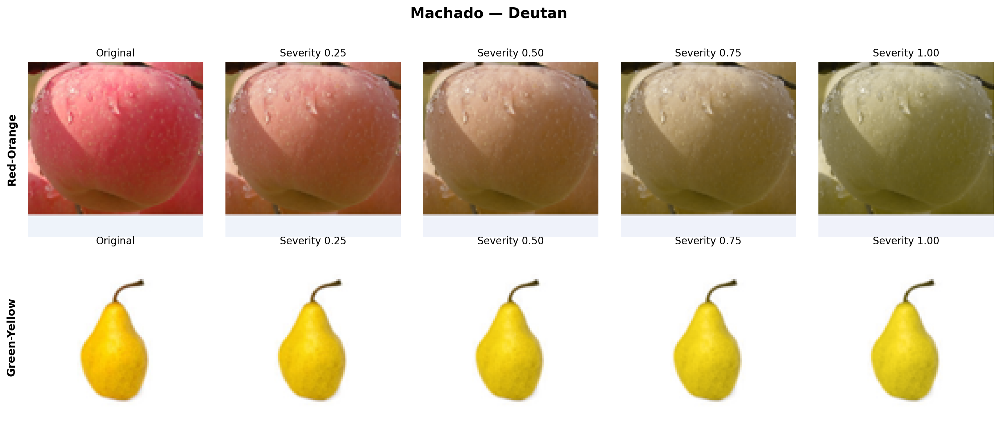
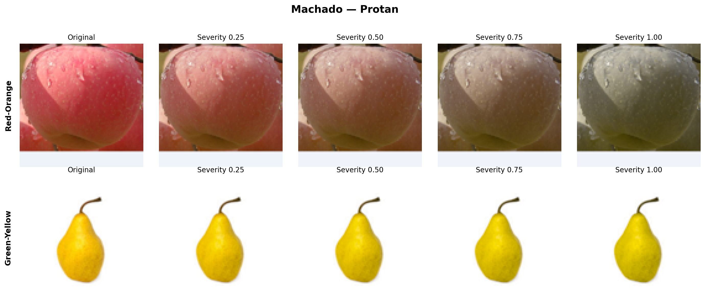

# Analisis Hasil NB02: Simulasi CVD

## Alur penelitian

```mermaid
flowchart LR
 A[3.190 citra terproses] --> B[BGR ke RGB dan normalisasi]
 B --> C[Inverse transfer sRGB]
 C --> D[RGB linear]
 D --> E[Pilih keluarga matriks CVD]
 E --> F[Ambil atau interpolasi matriks severity]
 F --> G[Transformasi matriks per piksel]
 G --> H[Catat out-of-gamut]
 H --> I[Clipping ke 0 sampai 1]
 I --> J[Forward transfer sRGB dan uint8]
 J --> K[25.520 citra simulasi]
```

### Penjelasan setiap tahap

1. **Memuat 3.190 citra terproses.** NB02 membaca manifest NB01 dan mengambil citra 512 x 512 piksel yang telah melalui deduplikasi serta audit hue. Setiap citra membawa identitas kelas dan domain warna agar hasil simulasi dapat dikelompokkan kembali tanpa menebak informasi dari nama file keluaran.
2. **Mengubah BGR menjadi RGB dan melakukan normalisasi.** OpenCV membaca citra dalam urutan kanal BGR, sedangkan tabel transformasi Machado digunakan pada urutan RGB. Kanal ditukar terlebih dahulu, kemudian nilai uint8 0 sampai 255 dibagi 255 agar berada pada rentang 0 sampai 1. Tahap ini hanya mengubah representasi data dan belum mensimulasikan CVD.
3. **Melakukan inverse transfer sRGB.** Nilai sRGB bersifat nonlinear karena telah dikodekan untuk tampilan. Fungsi transfer invers diterapkan per kanal untuk menghilangkan pengodean tersebut. Operasi ini diperlukan agar perkalian matriks dilakukan terhadap besaran RGB linear, bukan langsung terhadap nilai tampilan yang bergamma.
4. **Membentuk RGB linear.** Hasil inverse transfer merupakan array floating point yang mempertahankan hubungan linear terhadap intensitas. Array ini menjadi citra kerja utama untuk model Machado. Pemisahan tahap ini menegaskan bahwa RGB linear berbeda dari citra sRGB 0 sampai 1 meskipun keduanya memakai tiga kanal.
5. **Memilih keluarga matriks CVD.** Untuk setiap citra, notebook menjalankan dua keluarga transformasi, yaitu protan dan deutan. Pemilihan keluarga menentukan tabel koefisien 3 x 3 yang digunakan. Protan memodelkan perubahan yang berkaitan dengan respons cone L, sedangkan deutan berkaitan dengan respons cone M.
6. **Mengambil atau menginterpolasi matriks severity.** Engine menerima severity pada rentang 0 sampai 1. Jika nilai tersedia tepat pada tabel kelipatan 0,1, matriks tersebut disalin langsung. Jika berada di antara dua titik, engine mencari matriks bawah dan atas lalu melakukan interpolasi linear. Karena itu severity kontinu seperti 0,67 tetap dapat dihitung, walaupun eksperimen batch memakai 0,25; 0,50; 0,75; dan 1,00 sebagai titik pembanding tetap.
7. **Mentransformasikan setiap piksel.** Vektor RGB linear pada setiap piksel dikalikan dengan matriks Machado aktif. Operasi yang sama diterapkan pada seluruh posisi tanpa mengubah ukuran, bentuk, tekstur, atau susunan spasial citra. Hasil tahap ini adalah RGB linear simulasi yang nilainya masih dapat berada di luar rentang tampilan.
8. **Mencatat nilai out-of-gamut.** Sebelum ada nilai yang dipotong, notebook menghitung rasio piksel yang memiliki kanal di bawah 0, di atas 1, atau salah satunya. Diagnostik ini menyimpan informasi tentang seberapa sering transformasi menghasilkan warna yang tidak dapat direpresentasikan langsung oleh sRGB. Nilainya tidak diperlakukan sebagai skor kualitas atau akurasi klinis.
9. **Melakukan clipping ke rentang 0 sampai 1.** Nilai RGB linear yang berada di luar gamut dijepit ke batas terdekat agar dapat dikodekan menjadi citra yang valid. Clipping dilakukan setelah diagnostik dicatat, sehingga jumlah nilai yang hilang akibat pembatasan tetap dapat dianalisis.
10. **Menerapkan forward transfer sRGB dan membentuk uint8.** RGB linear hasil clipping dikodekan kembali dengan fungsi transfer sRGB, dikalikan 255, dibulatkan, dan dikonversi menjadi uint8. Kanal kemudian dikembalikan ke BGR ketika citra disimpan melalui OpenCV. Tahap ini menghasilkan file yang dapat ditampilkan oleh aplikasi dan perangkat lunak citra biasa.
11. **Menghasilkan 25.520 citra simulasi.** Setiap 3.190 citra diproses pada dua tipe CVD dan empat severity, sehingga jumlah yang diharapkan adalah \(3.190\times2\times4=25.520\). Bersama citra, notebook menyimpan tipe CVD, severity, matriks aktif, perubahan RGB, rasio piksel berubah, diagnostik clipping, progres, dan error. Seluruh hasil kemudian menjadi input evaluasi NB03.

Matriks bekerja pada RGB linear karena pencampuran sinyal cahaya bersifat linear. Penerapan langsung pada sRGB bergamma akan membiasakan perubahan, terutama pada nada gelap.

## Tujuan dan algoritma

NB02 mensimulasikan protan dan deutan pada severity 0,25; 0,50; 0,75; 1,00 untuk 3.190 citra. Seluruh 25.520 keluaran berhasil dalam 1.607,0 detik.

Normalisasi sRGB dilinearkan:

\[
c_{lin}=\begin{cases}c/12{,}92,&c\le0{,}04045,\\((c+0{,}055)/1{,}055)^{2{,}4},&lainnya.\end{cases}
\]

Matriks severity diinterpolasi:

\[
l=\lfloor10s\rfloor/10,\ u=\lceil10s\rceil/10,\
w=(s-l)/(u-l),\ M_s=(1-w)M_l+wM_u,
\quad \mathbf c'_{lin}=M_s\mathbf c_{lin}.
\]

Persamaan tersebut merupakan bentuk eksplisit interpolasi linear berbobot antara dua matriks Machado yang mengapit severity \(s\). Mekanismenya dirujuk ke [Jann (2022), bagian 6.8 pada halaman PDF 39](<../../../scripts/papers/BAB 2+3/2022_ColrSpace A Mata class for color management.pdf>), yang menetapkan severity pada rentang [0,1] dan menyatakan bahwa nilai severity antara diperoleh melalui interpolasi linear antarmatriks transformasi. Jika \(l=u\), matriks titik itu dipakai langsung. Setelah diagnostik gamut, nilai dijepit ke [0,1] dan dikodekan:

\[
c'=\begin{cases}12{,}92c'_{lin},&c'_{lin}\le0{,}0031308,\\1{,}055(c'_{lin})^{1/2{,}4}-0{,}055,&lainnya.\end{cases}
\]

Transformasi warna mengikuti model primer [Machado, Oliveira, dan Fernandes (2009), khususnya Persamaan (24)](<../../../scripts/papers/Referensi_Lama/2009_A Physiologically-based Model for Simulation of Color Vision Deficiency.pdf>):

\[
\mathbf c'_{lin}=\Gamma_{CVD}(s)\mathbf c_{lin}.
\]

Referensi 2009 tidak diganti karena merupakan sumber langsung model yang diimplementasikan. Relevansi dan keterbatasan simulator modern didukung oleh [evaluasi komparatif metodologi simulasi CVD (2025)](<../../../scripts/papers/semua/2025_Evaluating the accuracy of color vision deficiency simulation Methodologies and a comparative analysis of current models.pdf>) dan [model fisiologis warna CVD (2025)](<../../../scripts/papers/BAB 2/2025_A Physiologically-based simulation model of colorappearance for red-green color vision deficiency.pdf>). Paper 2025 adalah pembanding mutakhir, bukan sumber koefisien matriks Machado. Severity adalah posisi pada model numerik, bukan persentase diagnosis klinis.

Persamaan transfer sRGB di atas memiliki dukungan langsung dari literatur terbaru. [Mao, Wu, dan Feng (2022), Persamaan (1) pada halaman PDF 4](<../../../scripts/papers/BAB 2+3/2021_A Modeling Approach on the Correction Model of the Chromatic Aberration of Scanned Wood Grain Images.pdf>) menuliskan inverse sRGB dengan ambang 0,04045, pembagi 12,92, konstanta 0,055 dan 1,055, serta eksponen 2,4. Paper yang sama menuliskan forward sRGB pada Persamaan (8), halaman PDF 5, dengan ambang 0,0031308 dan eksponen \(1/2{,}4\). Tahun artikel yang benar adalah 2022, walaupun nama file lokal diawali 2021.

Inverse sRGB juga dituliskan dalam [Kuo dkk. (2025), Persamaan (3) pada halaman PDF 5](<../../../scripts/papers/BAB 2+3/2025_Small intestinal bleeding prediction by spectral reconstruction through band selection.pdf>). Forward sRGB diperkuat oleh [Lee dan Lee (2025), Persamaan (35) pada halaman PDF 7](<../../../scripts/papers/BAB 2+3/2025_Color Simulation of Multilayered Thin Films Using Python.pdf>) serta [Irwin dkk. (2024), Persamaan (1) pada halaman PDF 4](<../../../scripts/papers/BAB 2+3/2023_Modelling the seasonal cycle of Uranus’s colour and magnitude, and.pdf>). Artikel Irwin diterima pada 2023, tetapi terbit dalam MNRAS volume 527 tahun 2024. Keempat paper memakai konstanta yang sama dengan engine. Standar IEC 61966-2-1 tetap merupakan sumber normatif asal fungsi transfer, sedangkan paper 2022-2025 ini merupakan sumber jurnal langsung yang dapat dibuka dari folder lokal.

Diagnostik:

\[
D_{RGB}=\frac{\sum_{x,c}|I'_{x,c}-I_{x,c}|}{3HW\cdot255},\quad
r_{clip}=\frac1{HW}\sum_x\mathbf1[\exists c:c'_{lin}\notin[0,1]].
\]

### Keterlacakan rumus dan parameter

| Komponen | Status referensi | Sumber yang digunakan |
|---|---|---|
| Transformasi matriks CVD | Rumus model identik | Machado dkk. (2009), Persamaan (24). Dua paper 2025 mendukung relevansi dan pembandingan model. |
| Matriks pada titik severity | Koefisien implementasi model | Berasal dari data numerik atau material pendukung model Machado. Badan PDF lokal mendukung bentuk transformasi, tetapi tidak cukup untuk memverifikasi ulang seluruh elemen matriks severity satu per satu. |
| Interpolasi dua matriks terdekat | Prinsip dan operasi identik | Jann (2022), bagian 6.8 halaman PDF 39, menerapkan interpolasi linear antarmatriks Machado untuk severity antara pada rentang [0,1]. Bentuk bobot \(w\) di atas adalah penulisan eksplisit operasi linear tersebut. |
| Dekode dan enkode sRGB | Rumus dan konstanta identik | Mao, Wu, dan Feng (2022), Persamaan (1) dan (8), mencakup kedua arah. Kuo dkk. (2025) menguatkan inverse sRGB; Lee dan Lee (2025) serta Irwin dkk. (2024) menguatkan forward sRGB. |
| \(D_{RGB}\) dan \(r_{clip}\) | Definisi operasional penelitian | Dipakai untuk audit besar perubahan dan gamut. Tidak diklaim sebagai metrik klinis atau rumus Machado. |
| Severity 0,25; 0,50; 0,75; 1,00 | Titik eksperimen | Dipilih untuk perbandingan terkontrol. Engine tetap menerima severity kontinu melalui interpolasi. |

Karena itu, rumus utama simulator memiliki sumber yang dapat ditelusuri: transformasi dan koefisien matriks mengacu langsung pada Machado dkk. (2009), interpolasi severity mengacu pada Jann (2022), sedangkan konstanta sRGB dapat diverifikasi melalui jurnal 2022-2025. PDF IEC 61966-2-1 belum tersedia di folder lokal, tetapi keterlacakan rumus implementasi sRGB sudah dapat diverifikasi melalui Persamaan (1) dan (8) Mao, Wu, dan Feng (2022).

## Hasil

| Jenis-domain | Perubahan RGB 0,25; 0,50; 0,75; 1,00 | Clipping 0,25; 0,50; 0,75; 1,00 |
|---|---|---|
| deutan merah-oranye | 0,0403; 0,0634; 0,0787; 0,0900 | 0,1810; 0,1978; 0,1722; 0,1900 |
| protan merah-oranye | 0,0361; 0,0597; 0,0776; 0,0935 | 0,2080; 0,2354; 0,2179; 0,2378 |
| deutan hijau-kuning | 0,0109; 0,0179; 0,0227; 0,0266 | 0,1765; 0,1849; 0,1479; 0,1939 |
| protan hijau-kuning | 0,0118; 0,0202; 0,0268; 0,0326 | 0,2404; 0,2787; 0,2644; 0,3324 |

Perubahan meningkat bersama severity dan jauh lebih besar pada merah-oranye. Clipping tidak monoton dan sensitif terhadap latar putih yang sedikit melewati 1 akibat operasi matriks. Ia adalah diagnostik gamut.

## Gambar dan output aktif

### Simulasi deutan

Apel berubah kuat karena warna kulitnya banyak bergantung pada perbedaan sinyal merah-hijau. Ketika respons yang berkaitan dengan cone M dilemahkan, warna tersebut diproyeksikan ke rentang lebih sempit dan tampak kusam, cokelat, atau zaitun. Pir berubah lebih kecil karena warna kuning membawa kontribusi merah dan hijau bersama serta informasi luminans yang kuat.

### Simulasi protan

Pada protan, berkurangnya kontribusi yang berkaitan dengan cone L membuat area merah kehilangan saturasi dan dapat tampak lebih gelap. Pir tetap lebih stabil karena struktur dan luminans tidak dihilangkan. Perbedaan kedua gambar berasal dari koefisien matriks, bukan filter warna dekoratif.

Severity 0,25; 0,50; 0,75; dan 1,00 memberi tiga titik antara dan endpoint untuk memeriksa tren tanpa melipatgandakan penyimpanan. Interpolasi memungkinkan severity kontinu di antara tabel matriks. Nilai di luar gamut dicatat sebelum clipping agar kehilangan gamut dapat diaudit; clipping sendiri bukan skor kualitas perseptual.

| Output | Makna |
|---|---|
| `simulated_images/` | 25.520 citra aktif. |
| `simulation_report.csv` | Metrik tiap citra-kondisi. |
| `simulation_checkpoint.csv` | Daftar pekerjaan selesai. |
| `simulation_progress.csv` | Progres hingga lengkap. |
| `simulation_errors.csv` | Kosong, tidak ada error. |
| `simulation_summary.json` | Jumlah, kondisi, dan waktu. |
| dua PNG severity | Perubahan visual bertahap. |
